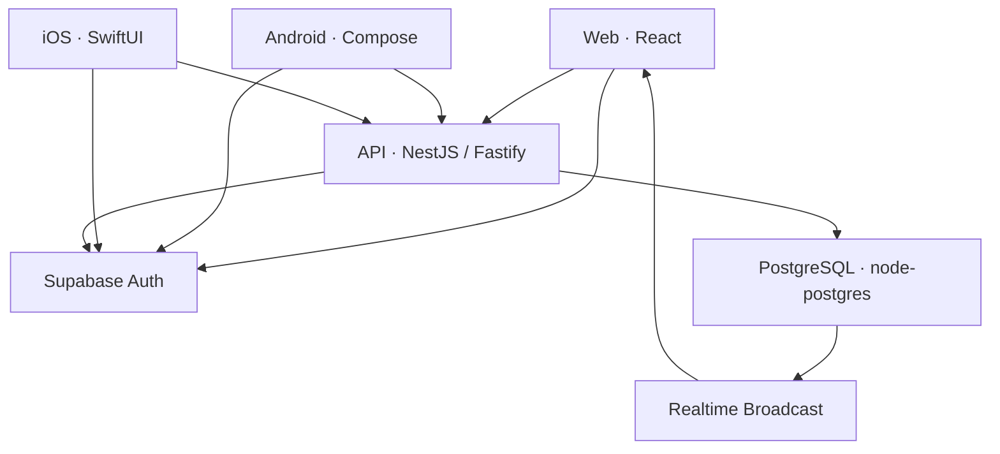
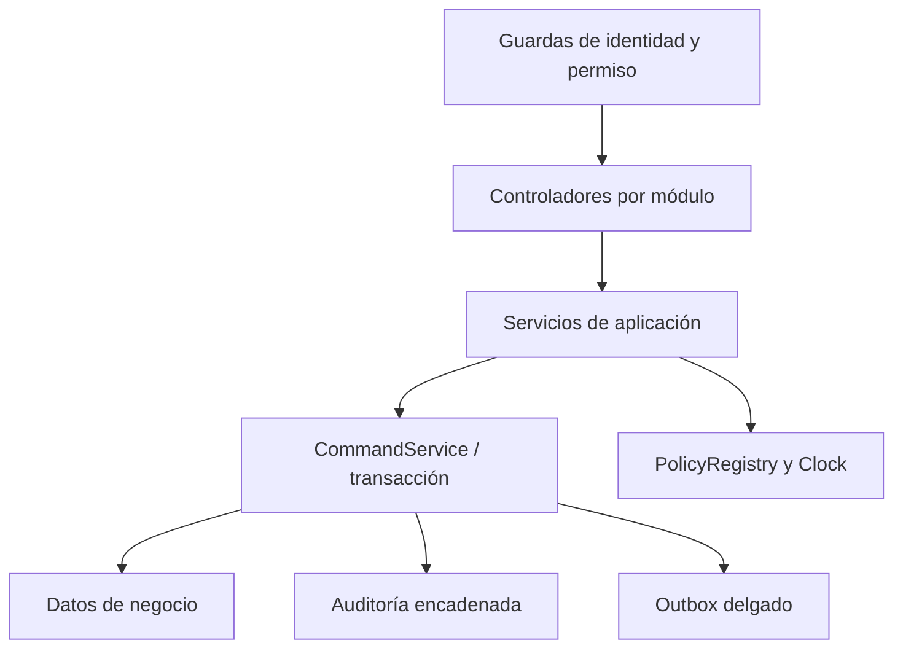
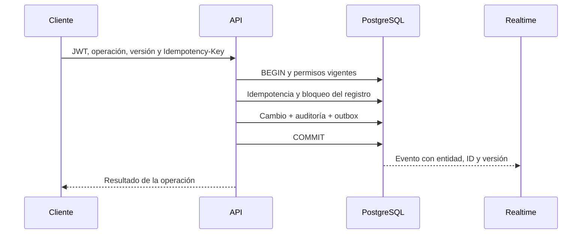

# Arquitectura de CLIMESA · corte S1/S2

Implementación vigente: Node.js + TypeScript según ADR-024. Las referencias ASP.NET/Npgsql de documentos históricos describen el punto de partida, no el código actual.

## Interacción de plataformas

Los tres clientes obtienen tokens de Supabase Auth. La API comprueba emisor, audiencia y vencimiento y valida la identidad con `auth.getUser`. Después resuelve cuenta activa, roles, permisos, plataformas y canales en la base. Ningún permiso se toma de `user_metadata`.

En este corte, Realtime se consume en web; Android e iOS actualizan por consulta y refresco. Sus suscripciones nativas corresponden a S3. La web combina Broadcast con recuperación de outbox cada cinco segundos y nueva consulta al reconectar. `publico` es un Broadcast público sin datos personales; los canales de rol y usuario son privados. Su política de autorización consulta la cuenta vigente.

## API modular

- `auth`: identidad y perfil efectivo.
- `users`: invitaciones, directorio de cuentas, roles y estado.
- `patients`: búsqueda fonética, constancia previa al registro, identificadores, historial y privacidad.
- `operations`: personal, turnos, espacios, camas, resumen, metadatos de auditoría y recuperación de eventos.
- `platform`: conexiones `pg`, transacciones, Clock, PolicyRegistry, idempotencia, auditoría y errores uniformes.

La base conserva un esquema por dominio. El core S1/S2 orquesta lecturas entre acceso, personal, pacientes, infraestructura y relaciones asistenciales para resolver permisos y operaciones compartidas; no es un conjunto de servicios desplegados por separado. Las transacciones usan el mismo `PoolClient`, con `SET LOCAL ROLE sghu_api` y tiempo máximo de consulta. Las invariantes concurrentes también están en SQL: índices únicos, exclusiones GiST y validadores del árbol.

## Escrituras

La clave de idempotencia se particiona por actor y operación, vincula el hash del cuerpo y conserva la respuesta completada. Una clave repetida con otro cuerpo devuelve 409. Una versión antigua devuelve 409. El último ADM activo está protegido en la API y mediante triggers SQL. La auditoría admite solo inserciones y cada hash incluye el anterior y el JSON canónico del evento. Los errores incluyen un código y un identificador de solicitud; no se registran contraseñas, tokens, cuerpos o criterios de búsqueda originales.

La invitación necesita dos sistemas: correo/Auth y la transacción de la aplicación. Su proveedor externo no participa en una transacción distribuida. Si Auth envía el enlace y luego falla el registro SQL, el administrador debe revisar la cuenta creada antes de reintentar; no se elimina automáticamente una identidad remota. Los reintentos de una operación completada son idempotentes.

## Clientes y secretos

Web: React, estado de sesión, módulos condicionados por rol, tipos de escritura generados desde OpenAPI y componentes responsive. Android: MVVM con ViewModels Hilt, repositorios HTTP y tokens cifrados mediante Keystore. iOS: SwiftUI/MVVM, servicios actor, URLSession y Keychain con accesibilidad solo en el dispositivo desbloqueado. Las tres plataformas verifican `/auth/me` antes de habilitar datos. Las contraseñas no se guardan; los pacientes remotos no se almacenan en disco.

Solo el servidor recibe `DATABASE_URL` y la clave privada necesaria para invitaciones. Web y apps usan la clave publicable. Docker empaqueta la API y expone un puerto local para colocarlo detrás de HTTPS. La web se compila con las URL públicas de Auth y API. La configuración de Release de las apps requiere el backend remoto.

## Validación y estado remoto

Las pruebas locales cubren HTTP, roles, migraciones, RLS, comandos y reglas de negocio con PGlite. PGlite usa un motor PostgreSQL con una sola conexión y no demuestra carreras multisesión; `compose.test.yaml` y el workflow `postgres-native` cubren ese entorno cuando se ejecuten con Docker. No hay Docker ni SDK móviles en este entorno. La cuenta conectada de Supabase no expone el proyecto CLIMESA: la migración nueva no fue aplicada en la nube y no hay una URL de API desplegada verificada.

FCM, APNs, Storage clínico y operaciones clínicas de S3–S5 siguen fuera del corte construido. Figma se sincronizará después de cerrar la implementación, según el orden solicitado.
