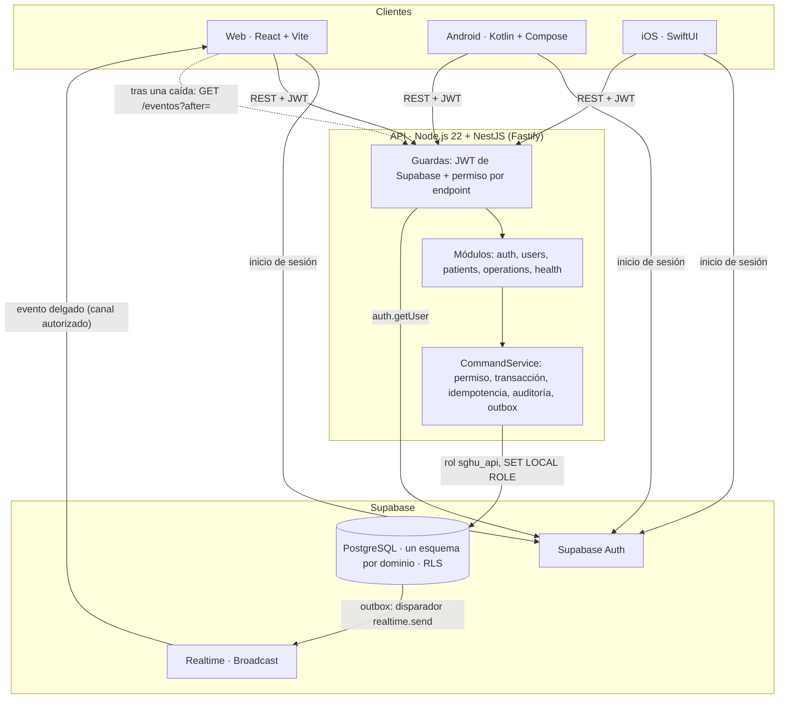
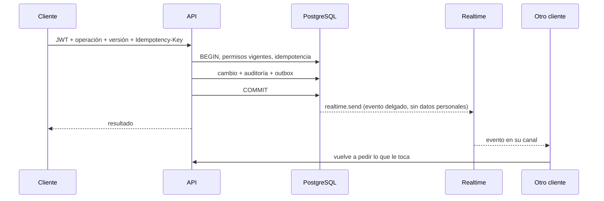
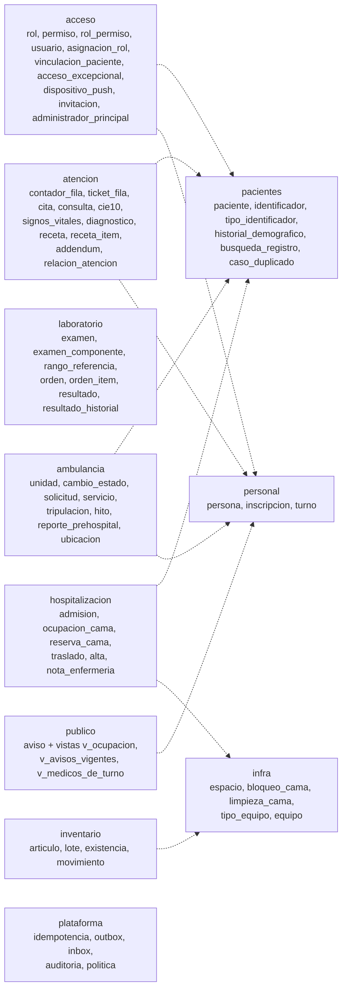
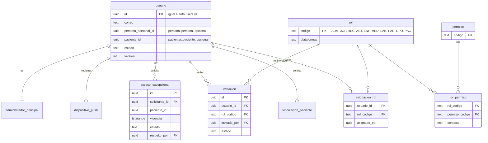
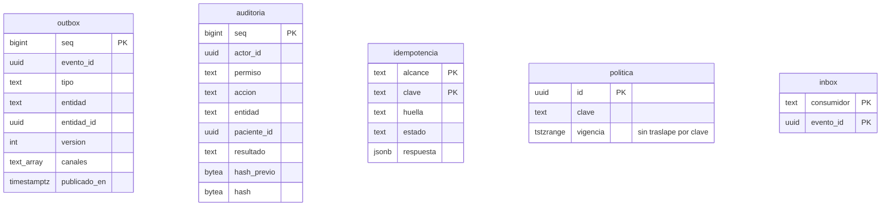
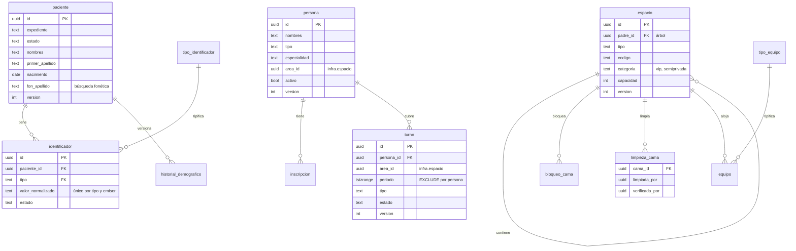
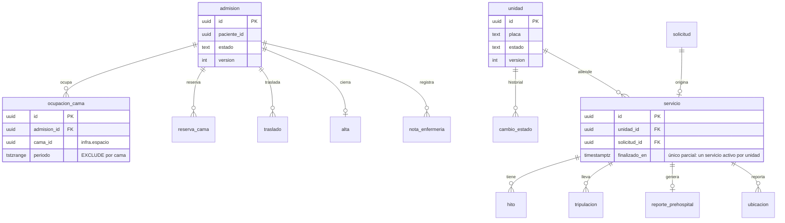
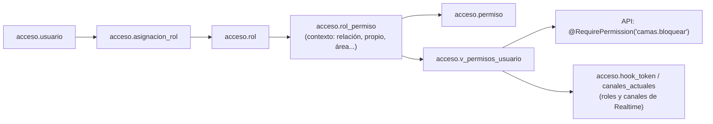

# Documento de arquitectura para el avance del 31 de octubre

Resumen visual del estado construido a la fecha (corte S1/S2, 29-oct-2026): diagrama de arquitectura, diagrama entidad-relación del esquema real, matriz de acceso (RBAC) y privacidad. Cubre FR-131-02 (parte HTML/Markdown; el PDF es la tarea 131-T05).

Este documento resume; la fuente de cada tema es:

| Tema | Fuente completa |
|---|---|
| Arquitectura y flujos de escritura | [arquitectura.md](arquitectura.md) |
| Modelo de datos del diseño completo (S1 a S5) | [modelo-datos.md](modelo-datos.md) |
| Esquema real (verdad) | `supabase/migrations/*.sql` |
| Matriz RBAC (generada, no editar) | [roles-y-permisos.md](roles-y-permisos.md), datos en `datos/permisos.csv` y `datos/roles.csv` |
| Privacidad por campo y por rol | [privacidad.md](privacidad.md) |
| Eventos y canales de tiempo real | [tiempo-real.md](tiempo-real.md) |
| Decisiones (ADR) | `docs/decisiones/adr/` y `docs/decisiones/registro-decisiones.md` |

## 1. Arquitectura

Puntos que el diagrama resume (detalle en [arquitectura.md](arquitectura.md)):

- Los clientes nunca consultan tablas de negocio: Supabase solo les da inicio de sesión y Realtime. La API es la única que escribe (regla 4 de `AGENTS.md`).
- Toda escritura pasa por `CommandService` en una sola transacción: cambio, auditoría encadenada y fila en `plataforma.outbox`. Si la transacción falla no hay evento.
- Tiempo real sin sondeo (regla 9): el evento llega por Broadcast, el cliente invalida y vuelve a pedir lo suyo. Solo tras una caída o al volver la red se hace una consulta de recuperación a `/eventos`. En este corte solo la web tiene suscripción; Android e iOS la incorporan en S3 (ver [arquitectura.md](arquitectura.md)).
- Secretos: `DATABASE_URL` y la clave privada solo en el servidor; los clientes usan la clave publicable.

### Flujo de una escritura con tiempo real

## 2. Diagrama entidad-relación del esquema real

Verificado contra `supabase/migrations/` (16 archivos: 13 base, 2 de invitaciones y `core_semanas_1_2`). Un esquema PostgreSQL por dominio; las referencias entre esquemas son llaves lógicas sin llave foránea (convención de [modelo-datos.md](modelo-datos.md)), por eso aparecen como `uuid` sin relación dibujada. Solo se listan columnas clave. `modelo-datos.md` conserva el diseño objetivo completo; donde difiere de las migraciones, manda la migración.

### 2.1 Mapa de esquemas

Operaciones de API implementadas en este corte: `acceso`, `pacientes`, `personal`, `infra` (espacios, camas) y la lectura de estado de `ambulancia`. Las tablas de `atencion`, `laboratorio`, `hospitalizacion`, `inventario`, el resto de `ambulancia` y `publico` ya existen en el esquema, pero sus operaciones corresponden a S3 a S5.

### 2.2 Acceso y plataforma

`plataforma` no tiene llaves foráneas hacia los demás esquemas: el actor y la entidad se guardan como identificadores. La auditoría solo admite inserciones y cada hash incluye el anterior.

### 2.3 Pacientes, personal y edificio

`pacientes.busqueda_registro` (constancia de búsqueda previa al registro) y `pacientes.caso_duplicado` complementan el módulo sin llaves foráneas.

### 2.4 Hospitalización y ambulancia

### 2.5 Invariantes verificadas en las migraciones

| Invariante | Mecanismo encontrado |
|---|---|
| Una cama, un paciente a la vez | `exclude using gist (cama_id with =, periodo with &&)` en `hospitalizacion.ocupacion_cama` (y en `reserva_cama` activa) |
| Una admisión activa por paciente | índice único parcial `admision_activa_unica` |
| Una persona sin turnos traslapados | `exclude using gist (persona_id with =, periodo with &&) where (estado <> 'cancelado')` en `personal.turno` |
| Un médico sin dos citas a la vez | `exclude using gist (medico_id with =, horario with &&)` en `atencion.cita` |
| Un servicio activo por ambulancia | índice único parcial `servicio_activo_unico` sobre `ambulancia.servicio (unidad_id) where finalizado_en is null` |
| Una limpieza abierta por cama | índice único parcial `limpieza_abierta_unica` |
| DUI y demás identificadores únicos | índice único `identificador_exclusivo (tipo, emisor, valor_normalizado)` |
| Un diagnóstico principal por consulta | índice único parcial `diagnostico_principal_unico` |
| Último administrador protegido | triggers `proteger_ultimo_admin` y `proteger_desactivacion` en `acceso.usuario` |
| Políticas sin traslape | `exclude using gist (clave with =, vigencia with &&)` en `plataforma.politica` |
| RLS en las tablas de negocio | migración `..._seguridad.sql` habilita RLS por esquema; Realtime autoriza canales con la política `sghu_escuchar_canales` en `realtime.messages` |

El número de fila (`atencion.ticket_fila`) y la existencia de inventario también tienen restricciones en sus migraciones; sus operaciones llegan en S3 a S5.

## 3. Control de acceso (RBAC)

La matriz completa, con los 10 roles y cada permiso, se **genera** desde `datos/permisos.csv` y `datos/roles.csv`: [roles-y-permisos.md](roles-y-permisos.md). Aquí solo el mecanismo y el resumen de roles.

- El código pregunta por **permiso**, nunca por rol (regla 8). El permiso se resuelve en la base con la cuenta vigente; nada se toma de `user_metadata`.
- Nadie se asigna roles a sí mismo ni aprueba su propio acceso excepcional; el último administrador activo no se puede desactivar.
- Pruebas de arquitectura (`api/tests/architecture.spec.ts`) verifican que cada endpoint de negocio tenga guarda y permiso.

| Rol | Plataformas | Función |
|---|---|---|
| ADM | Web | Usuarios, roles, edificio y catálogos; no ve contenido clínico |
| JOP | Web | Opera el día: camas, turnos, ambulancia, inventario |
| REC | Android; Web | Registro de pacientes, fila, citas, admisión, camas |
| AST | Android | Apoyo de consulta y signos vitales |
| ENF | Android | Cuidado del hospitalizado, limpieza de cama |
| MED | iOS; Android | Consulta, diagnósticos, órdenes, alta |
| LAB | Web; Android | Órdenes y resultados de laboratorio |
| PAR | Android | Tripulación de la ambulancia |
| DPD | Web | Accesos excepcionales y auditoría |
| PAC | Android; iOS | Su propio expediente, citas y resultados revisados |

La web del corte actual atiende ADM, JOP, REC, LAB y DPD; los demás roles ingresan por móvil.

## 4. Privacidad

Política técnica completa: [privacidad.md](privacidad.md). Resumen:

| Clase | Quién la ve |
|---|---|
| Pública | Cualquiera, sin sesión (ocupación agregada, médicos de turno, avisos, números de fila llamados) |
| Interna | Personal con sesión según permiso (estado de camas sin ocupante, ambulancia, turnos) |
| Personal | Paciente dueño y personal que lo atiende o registra |
| Clínica (sensible) | Paciente dueño (lo revisado), equipo con relación de atención, o acceso excepcional aprobado |

- ADM y JOP ven lo necesario para operar, **nunca** lo clínico por su rol; para verlo piden un acceso excepcional que aprueba el DPD (otra persona), vence solo y queda auditado.
- Toda lectura de datos de paciente queda auditada (regla 7). Los eventos de Realtime son delgados: entidad, identificador y versión, sin datos personales.
- Sesión web: cierre a los 15 minutos de inactividad. Sesión móvil: cierre al volver tras 5 minutos en segundo plano.
- Las búsquedas de pacientes guardan una huella de los criterios, no el texto original, y exigen buscar antes de registrar.
- Datos de prueba siempre ficticios.

## 5. Estado del corte y límites

- Construido y probado localmente: API con PGlite (ver el [README raíz](../../README.md#validación)), web, fuentes Android e iOS.
- Entorno demo desplegado en Render sobre Supabase; los pendientes de configuración remota están en [ges-15-supabase-remoto.md](../desarrollo/ges-15-supabase-remoto.md).
- Pendiente de S3 a S5: operaciones clínicas, suscripciones nativas de Realtime, notificaciones push, Storage clínico.
- Este documento no incluye el enlace a Figma (131-T03); la sincronización de Figma está diferida por indicación del equipo.
- Fuera de este documento: el PDF de arquitectura (131-T05) y la trazabilidad requisito, spec, prueba (FR-131-06).
