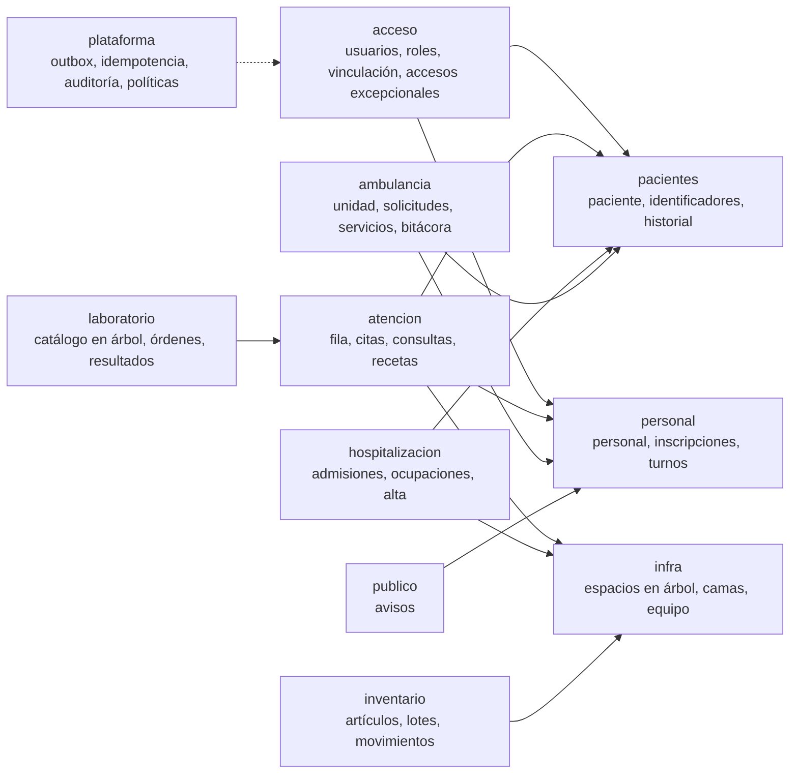
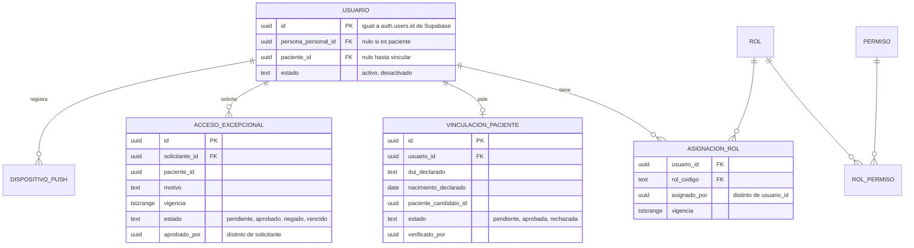
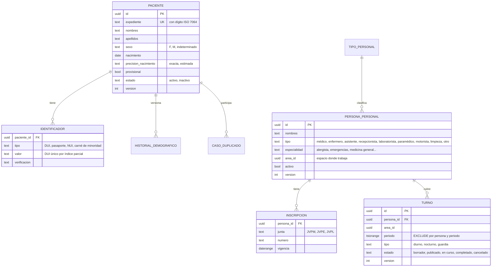
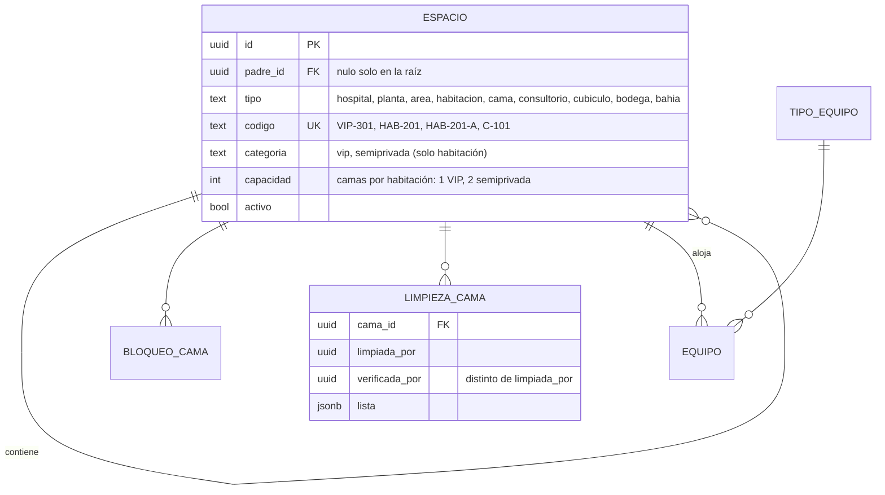
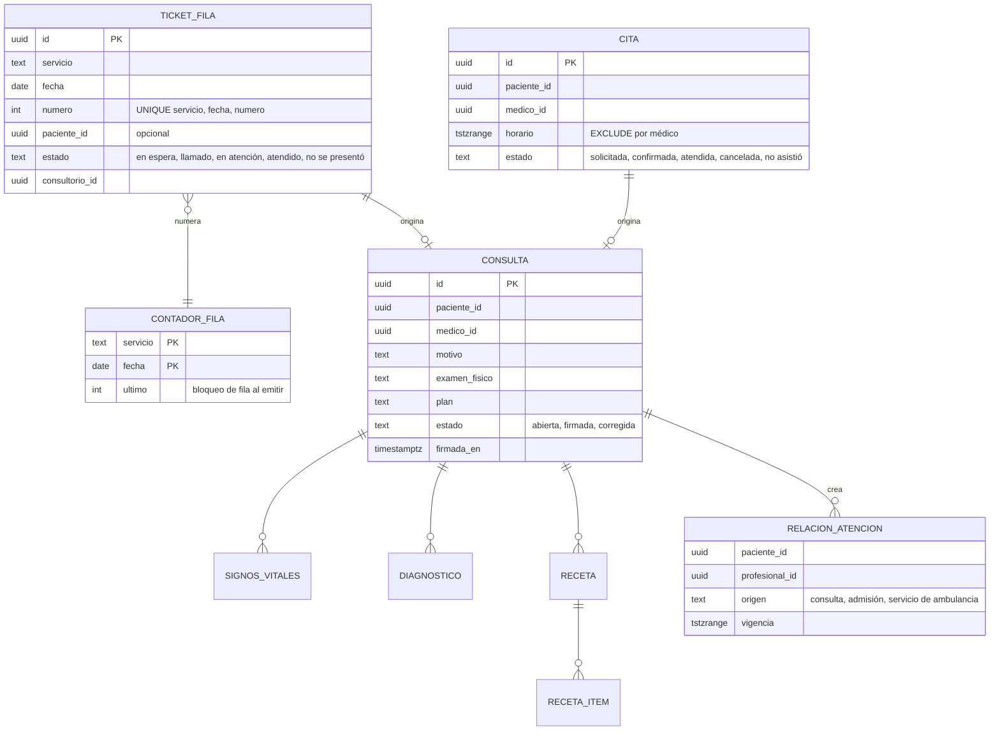
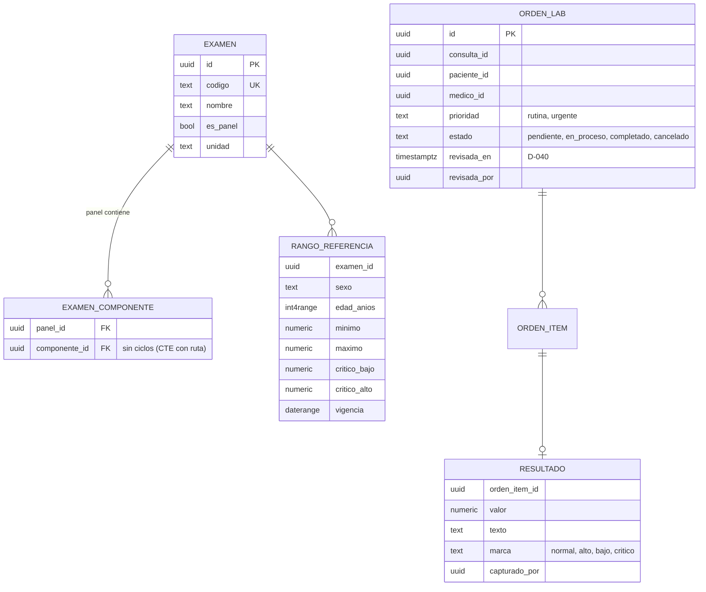
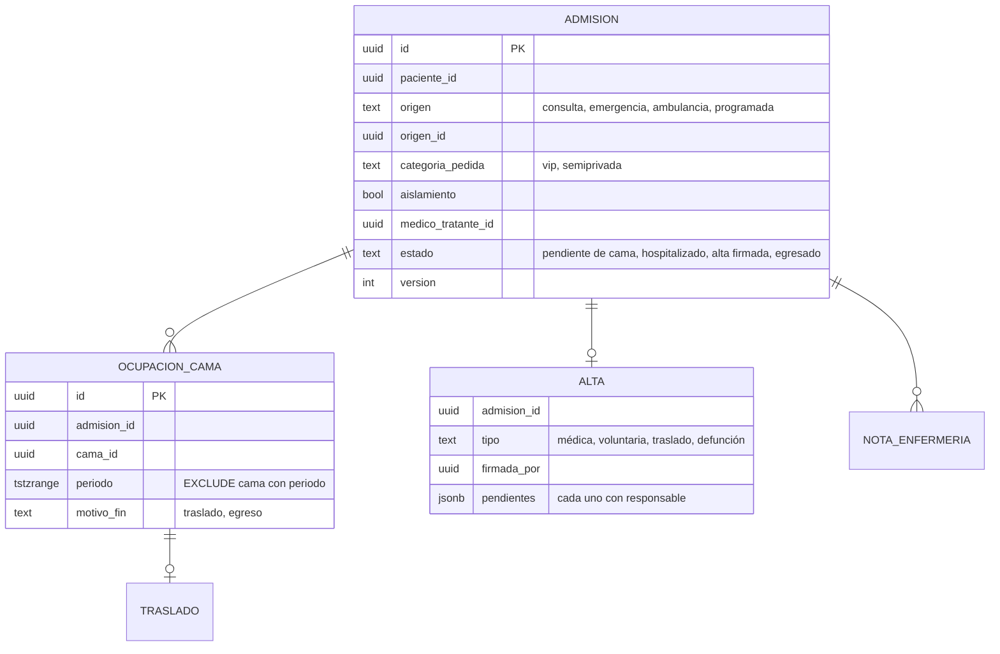
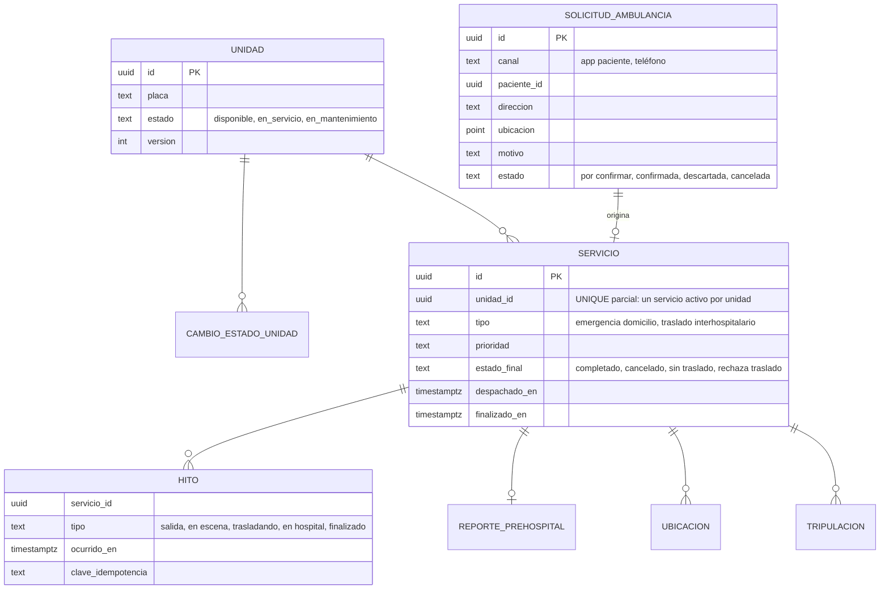
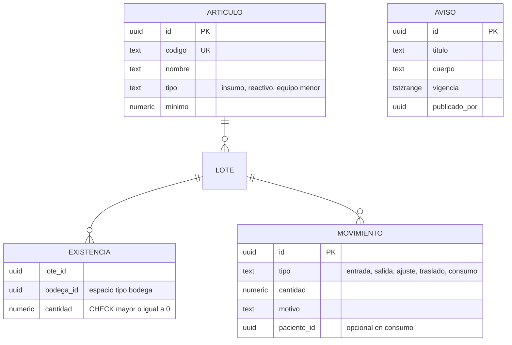

# Modelo de datos

Requisitos: diagrama de base de datos con modelos de doctores, pacientes, turnos, habitaciones (VIP y semiprivadas), administración, laboratorio y ambulancia (documentación del curso, punto 2). Decisiones: D-002, D-013, D-053, D-062, D-063. ADR-0004, ADR-0007.

Convenciones: un esquema PostgreSQL por módulo; llaves `uuid` generadas en la base; `version int` para concurrencia optimista en tablas editables; `creado_en`, `creado_por`; instantes `timestamptz`. Ningún módulo lee ni escribe tablas de otro. Un módulo puede publicar **vistas de solo lectura** con prefijo `v_` como parte de su contrato (por ejemplo `hospitalizacion.v_ocupacion_activa`); solo esas vistas se consultan desde otro esquema. El modelo completo contiene también módulos de semanas posteriores. El core S1/S2 usa vistas e información de relación de los esquemas vecinos para orquestar autorización, camas y turnos; conserva cada escritura en el esquema de su dominio. Las relaciones entre esquemas son llaves lógicas, sin llaves foráneas cruzadas. El cliente accede únicamente a la API; RLS impide el acceso directo a tablas de negocio.

Corte actual: 14 migraciones SQL, semilla con 17 camas (12 semiprivadas y 5 VIP), diez roles y 75 permisos. La revisión local carga todas las migraciones; el estado remoto de la nueva migración está pendiente de conexión al proyecto correcto.

## Vista general



## Plataforma y acceso



Tablas de plataforma (heredadas del legado, `docs/legado/climesa-his-v0/src/Climesa.Platform/Sql/0001_platform.sql`): `outbox` (evento, canal, carga delgada, publicado_en), `idempotencia` (alcance, clave, huella del contenido, resultado), `auditoria` (actor, acción, paciente, resultado, motivo, hash previo, hash; solo inserción), `politica` (clave, valor json, vigencia `tstzrange` sin traslape, fuente, aprobador).

## Pacientes y personal



## Infraestructura y recursos (árbol)



La semilla crea: Hospital > Planta 1 (recepción, sala de espera, C-101 a C-104, Emergencia con E-01 a E-03, Laboratorio, bahía de ambulancia, bodega) > Planta 2 (HAB-201 a HAB-206, cada una con camas A y B: 12 camas) > Planta 3 (VIP-301 a VIP-305, una cama cada una). La capacidad la impone un disparador: una habitación no puede tener más camas activas que su `capacidad`.

Consulta recursiva típica (disponibilidad por planta):

```sql
with recursive arbol as (
  select id, padre_id, tipo, codigo, id as planta_id
  from infra.espacio where tipo = 'planta'
  union all
  select e.id, e.padre_id, e.tipo, e.codigo, a.planta_id
  from infra.espacio e join arbol a on e.padre_id = a.id
)
select planta_id,
       count(*) filter (where tipo = 'cama') as camas,
       count(*) filter (where tipo = 'cama' and id not in (select cama_id from hospitalizacion.v_ocupacion_activa)) as libres
from arbol group by planta_id;
```

## Atención: fila, citas, consulta



## Laboratorio (catálogo en árbol)



## Hospitalización



## Ambulancia



## Inventario y avisos



## Invariantes garantizadas por la base de datos

| Invariante | Mecanismo |
|---|---|
| Una cama, un paciente a la vez | `EXCLUDE USING gist (cama_id with =, periodo with &&)` en `ocupacion_cama` |
| Habitación no supera su capacidad | Disparador sobre `espacio` (camas activas por habitación menores o iguales a capacidad) |
| Una persona no tiene turnos traslapados | `EXCLUDE USING gist (persona_id with =, periodo with &&)` en `turno` donde estado no es cancelado |
| Un médico no tiene dos citas a la vez | `EXCLUDE` sobre `(medico_id, horario)` en citas activas |
| Un servicio activo por ambulancia | Índice único parcial sobre `servicio(unidad_id)` donde `finalizado_en is null` |
| Número de fila único y sin huecos | `UNIQUE (servicio, fecha, numero)` y contador con `FOR UPDATE` |
| Existencia no negativa | `CHECK (cantidad >= 0)` y movimiento en la misma transacción |
| DUI único entre identificadores vigentes, incluso de pacientes inactivos | Índice único parcial en `identificador` |
| Auditoría inmutable | Rol de la API solo con `INSERT` y `SELECT`; hash encadenado |
| Quien verifica la limpieza no es quien limpió | `CHECK (verificada_por <> limpiada_por)` |
| Nadie se asigna roles ni aprueba su propio acceso | `CHECK` sobre `asignado_por` y `aprobado_por` |
