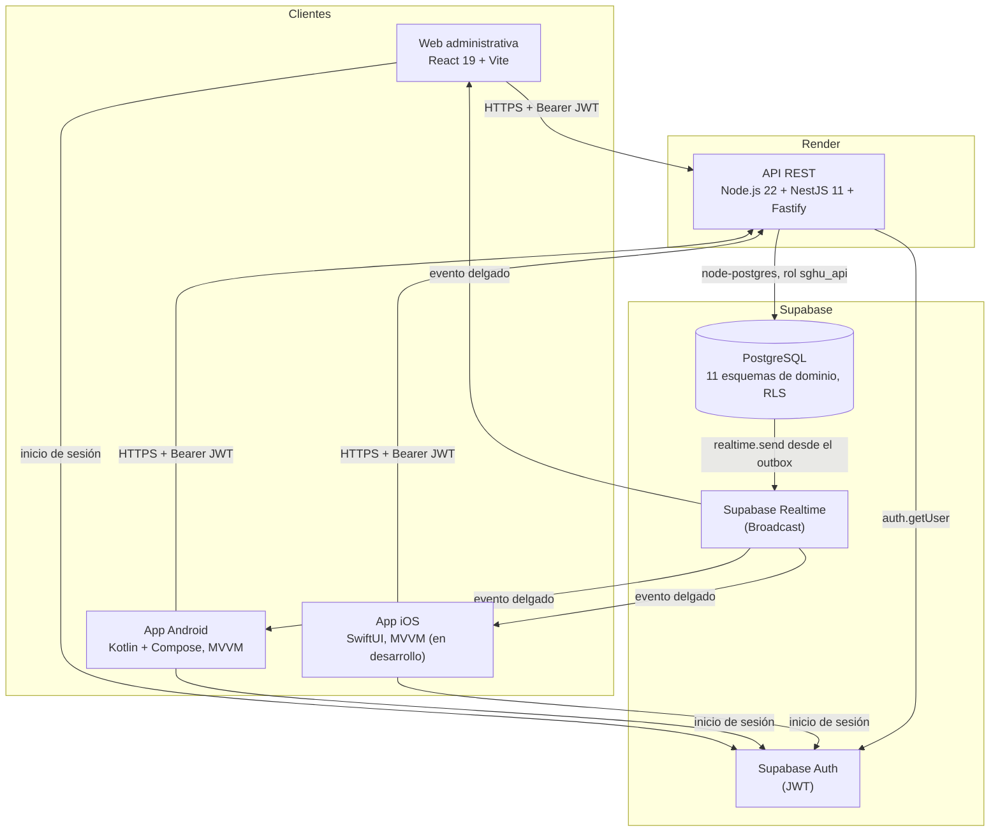
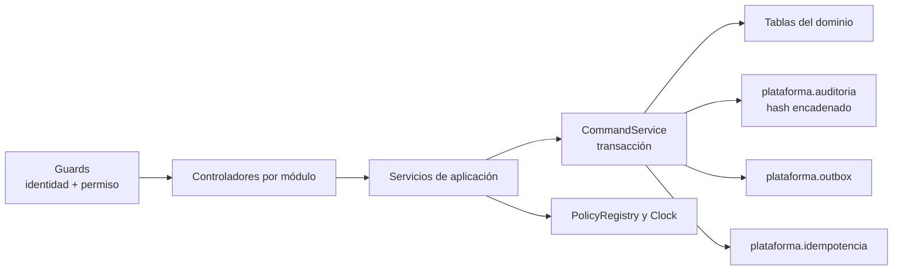
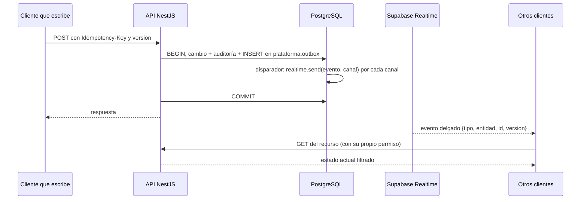
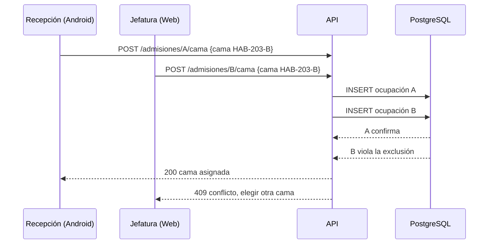
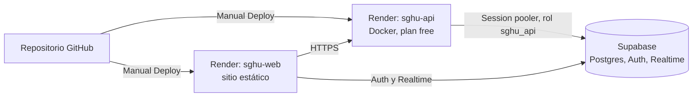

# Documento de Arquitectura · CLIMESA (SGHU)

Sistema de Gestión Hospitalaria Universitaria · Proyecto final de Desarrollo de Aplicaciones Móviles Avanzadas (DAMA) · Entrega y defensa: 21 de noviembre de 2026.

> Todos los datos del sistema, de las pruebas y de este documento son ficticios.
>
> Este documento describe el código de la rama `feat/r-docs-entrega`, basada en `fix/fase0-api` (commit `575d998`, 13-nov-2026). Cada afirmación remite a un archivo del repositorio. Lo que no está en esta rama se marca **en desarrollo** o **pendiente**: ambulancia (solicitud, despacho y bitácora), información pública, módulo del delegado de protección de datos (DPD) e historial clínico completo del paciente se construyen en ramas paralelas y no se describen como terminados.

## Contenido

1. Contexto y alcance
2. Diseño UX/UI (Figma y sistema de diseño)
3. Arquitectura de software
4. Módulos y estado por módulo
5. Clientes (web, Android, iOS)
6. Modelo de datos
7. Seguridad y control de acceso por rol (RBAC)
8. Política de privacidad de datos
9. Tiempo real
10. Idempotencia y concurrencia optimista
11. Despliegue
12. Integración continua
13. Calidad y pruebas
14. Decisiones de arquitectura
15. Limitaciones conocidas
- Anexo A. Endpoints implementados y permiso requerido
- Anexo B. Matriz completa de permisos por rol

---

## 1. Contexto y alcance

El curso pide un ecosistema multiplataforma para un hospital universitario: app iOS nativa (médicos y pacientes), app Android nativa (recepción, asistencia, enfermería y médicos) y un panel web administrativo (administración y jefatura de operaciones). Las reglas de negocio del curso son:

| Regla del curso | Cómo se modela en CLIMESA |
|---|---|
| 3.ª planta: 5 habitaciones VIP individuales (VIP-301 a VIP-305) | `supabase/seed.sql`: área `P3-VIP`, habitaciones `VIP-301`…`VIP-305`, categoría `vip`, capacidad 1 |
| 2.ª planta: 6 habitaciones semiprivadas de 2 camas (HAB-201 a HAB-206), 12 camas | `supabase/seed.sql`: área `P2-HOS`, habitaciones `HAB-201`…`HAB-206`, categoría `semiprivada`, capacidad 2 |
| Sin sobrecupo ni doble asignación de camas | Disparador de capacidad en `infra.espacio` y `EXCLUDE USING gist` sobre la ocupación de cama (sección 6.3) |
| Turnos del personal | Esquema `personal` (`persona`, `inscripcion`, `turno`) con exclusión de traslapes |
| Consulta general y laboratorio con estados Pendiente, En Proceso, Completado | `laboratorio.orden.estado` admite `pendiente`, `en_proceso`, `completado` y `cancelado` |
| Información pública frente a privada | Política de la sección 8; la pantalla pública está **en desarrollo** |
| Una sola ambulancia con estados Disponible, En Servicio, En Mantenimiento | `ambulancia.unidad.estado` con esos tres valores; la semilla crea una única unidad. Solicitud y despacho **en desarrollo** |

Roles del sistema (10): ADM (administración técnica), JOP (jefatura de operaciones), REC (recepción), AST (asistencia), ENF (enfermería), MED (médico), LAB (laboratorio), PAR (paramédico), DPD (delegado de protección de datos) y PAC (paciente). El catálogo está en `docs/arquitectura/datos/permisos.csv` (79 permisos).

## 2. Diseño UX/UI (Figma y sistema de diseño)

| Entregable | Ubicación | Estado |
|---|---|---|
| Archivo de Figma | https://www.figma.com/design/bHJjbgi64I0p0Bnw8nho8e | Versión anterior. **No está sincronizado** con las pantallas actuales (`README.md`, sección "Figma y alcance") |
| Sistema de diseño (paleta clara y oscura, tipografía, estados de componentes) | `docs/diseno/claude-design/01-sistema-claro.html`, `02-sistema-oscuro.html`, `04-estados-y-avisos.html` | En HTML, versionado en el repositorio |
| Prototipos por rol y plataforma | `docs/diseno/claude-design/05-…` a `19-…` (web por rol y Android por rol) | En HTML |
| Inventario de pantallas (códigos W, A, I) | `docs/diseno/inventario-pantallas.md`, `docs/arquitectura/datos/pantallas.csv` | Generado por `tools/` |

Decisiones de diseño registradas: D-068 (tipografía Atkinson Hyperlegible Next y Mono, íconos Material Symbols Rounded), D-070 (azul CLIMESA `#0043B2`; cada estado con tono, forma, ícono y palabra), D-071 (avisos en tres niveles), D-072 (atajos de teclado que se pueden apagar, WCAG 2.1.4) y D-073 (ocho estados por pantalla). Fuente: `docs/decisiones/registro-decisiones.md`.

La web incluye una galería de revisión sin credenciales (`/work-preview.html` y `/design-preview.html` en el servidor de desarrollo) con los mismos componentes del producto y datos ficticios en memoria.

## 3. Arquitectura de software

### 3.1 Vista general

CLIMESA es un **monolito modular** (ADR-0001): una sola API propia sobre Supabase. Supabase aporta PostgreSQL, Auth (inicio de sesión) y Realtime (difusión de eventos). Los clientes **nunca** consultan tablas de Supabase directamente: solo usan Supabase para iniciar sesión y escuchar eventos. Toda escritura y toda lectura de datos de negocio pasa por la API (`AGENTS.md`, regla 4).

### 3.2 Flujo de una petición

1. El cliente obtiene un JWT de Supabase Auth.
2. La API valida el token con `auth.getUser` (`api/src/auth/supabase-auth.guard.ts`) y carga desde la base la cuenta, sus roles y sus permisos vigentes. Ningún permiso se toma de `user_metadata`.
3. El guard de permisos (`api/src/auth/permission.guard.ts`) compara el permiso que exige el endpoint (`@RequirePermission(...)`) con los permisos de la cuenta.
4. El servicio de aplicación ejecuta la operación dentro de una transacción con `SET LOCAL ROLE sghu_api` (`api/src/platform/database.service.ts`).
5. Las escrituras pasan por `CommandService`: idempotencia, cambio de datos, auditoría encadenada y evento en el outbox, todo en la misma transacción (sección 10).
6. Los errores se devuelven como `application/problem+json` con un código y un identificador de solicitud.

### 3.3 Estructura interna de la API

Carpetas de `api/src`: `auth`, `users`, `patients`, `operations` (personal, turnos, espacios, camas, ambulancia, auditoría y eventos), `attention` (citas, fila, consulta, expediente de la consulta), `laboratory`, `hospitalization`, `inventory`, `health`, `platform` y `supabase`. La arquitectura de módulos se comprueba con `api/tests/architecture.spec.ts`.

## 4. Módulos y estado por módulo

Estados: **Implementado** (API y al menos un cliente en esta rama), **Parcial** (existe una parte; se indica cuál falta), **En desarrollo** (se construye en una rama paralela; no está en esta rama).

| Módulo | API (esta rama) | Web | Android | Estado |
|---|---|---|---|---|
| Identidad y perfil (`/auth/me`) | Sí | Sí | Sí | Implementado |
| Usuarios, invitaciones y roles | `/usuarios`, `/usuarios/invitaciones`, roles y estado | Sí | — | Implementado |
| Pacientes (búsqueda, registro, provisionales, duplicados, ficha filtrada) | `/pacientes/*` | Sí | Recepción | Implementado |
| Personal e inscripciones | `/personal/*` | Sí | JOP (consulta) | Implementado |
| Turnos del personal | `/turnos/*` (publicación automática, cobertura, mis turnos) | Sí | Mis turnos, planificación | Implementado |
| Edificio y espacios (árbol) | `/espacios/*` | Sí | — | Implementado |
| Tablero de camas, bloqueo y limpieza | `/camas/*` | Sí | Tablero de camas | Implementado. Limpieza en Android pendiente (A52) |
| Citas de 20 minutos | `/citas/*` | Sí | Mis citas (PAC) | Implementado. Citas de recepción en Android pendiente (A32) |
| Fila del día | `/fila/*` | Sí | Emitir número, Mi turno, Mi consultorio | Implementado |
| Consulta general (borrador, signos, diagnósticos CIE-10, receta, firma) | `/consultas/*` | Mi consultorio | Mi día, Consulta | Implementado |
| Laboratorio (orden, muestra con doble identificación, resultados, validación, revisión) | `/laboratorio/*` | Sí (MED ordena desde la consulta) | Sí (MED ordena desde la consulta) | Implementado |
| Hospitalización (admisión, sugerencia y asignación de cama, traslado, notas, alta, salida) | `/admisiones/*`, `/ocupaciones/{id}/traslado` | Sí, salvo notas de enfermería | Asignación de cama, alta y salida (Admisión y cama, Mi planta, Mis hospitalizados) | Implementado. Notas de enfermería y traslado sin pantalla Android |
| Inventario (existencias, movimientos, artículos) | `/inventario/*` | Sí | Consumo de insumos | Implementado |
| Auditoría (consulta de metadatos) | `GET /auditoria` | Sí | — | Parcial: sin filtros ni verificación de cadena expuesta |
| Ambulancia: estado y mantenimiento | `GET /ambulancia`, `POST /ambulancia/mantenimiento` | Sí | Unidad (A70) | Parcial |
| Ambulancia: solicitud, despacho, hitos, prehospital, bitácora | No | No | No (`ready=false`) | **En desarrollo** (esquema ya existe) |
| Información pública (ocupación, médicos de turno, avisos) | No | No | No (A10 `ready=false`) | **En desarrollo** (tabla `publico.aviso` existe) |
| Privacidad y DPD (accesos excepcionales, "quién vio mi expediente") | No | No (módulo marcado `future`) | No (A11 `ready=false`) | **En desarrollo** |
| Historial clínico del paciente | No existe `/pacientes/{id}/historial` | Vista mínima del médico desde su agenda (`/consultas/{id}/detalle`) | No (A08, A22 `ready=false`) | Parcial / **en desarrollo** |
| Vinculación de cuenta PAC con expediente | No | No | No (A33 `ready=false`) | **En desarrollo** |
| Métricas y notificaciones push | No | No | No | Pendiente |

Fuentes: controladores en `api/src/**/*.controller.ts`, menú web en `web/src/features/shell.tsx`, secciones Android en `android/app/src/main/java/sv/edu/catolica/climesa/domain/AuthModels.kt` (campo `ready`).

## 5. Clientes

### 5.1 Web administrativa (`web/`)

- React 19.1, TypeScript 5.7, Vite 6.2; pruebas con Vitest.
- El menú depende solo del permiso (`web/src/features/shell.tsx`): cada módulo declara el permiso que lo abre; nunca se pregunta por el rol.
- Tipos de la API generados desde `contrato/openapi.json` (`web/src/lib/generated/`).
- Tiempo real con Supabase Realtime en `web/src/lib/live.ts` (sección 9).
- Sesión del personal con cierre por inactividad a los 15 minutos (`docs/arquitectura/privacidad.md`, regla 6).

### 5.2 Android (`android/`)

- Kotlin 2.1.20, Jetpack Compose (BOM 2025.04.01) con Material 3, Hilt 2.57.1, corrutinas y `StateFlow`, OkHttp 4.12. `minSdk` 26, `targetSdk`/`compileSdk` 35. `applicationId` `sv.edu.catolica.climesa`.
- Patrón **MVVM**: pantallas Compose (`*Screen.kt`) que observan `ViewModel` con `StateFlow`; los ViewModel llaman a repositorios HTTP de forma asíncrona con corrutinas (`viewModelScope.launch`).
- Las secciones se habilitan por permiso (`AndroidSection` en `domain/AuthModels.kt`); las que no están listas muestran su estado pendiente.
- Tiempo real nativo: `ui/realtime/OkHttpRealtimeSocket.kt`, `RealtimeRepository.kt`. Al llegar un evento se vuelven a pedir fila, laboratorio, consulta, admisiones e inventario.
- La sesión se guarda cifrada con Android Keystore; los pacientes remotos no se guardan en disco.
- URL de la API: Debug usa `http://10.0.2.2:3000/api/v1` (emulador) salvo que `CLIMESA_API_BASE_URL` la sobrescriba; Release usa `https://sghu-api.onrender.com/api/v1` (`android/app/build.gradle.kts`).

### 5.3 iOS (`ios/`)

- SwiftUI con MVVM (`@Observable` y servicios `actor`), `URLSession` con `async/await` y Keychain (`WhenUnlockedThisDeviceOnly`). iOS 17+, Xcode 15+.
- Roles: Médico (Mi día, Pacientes, Resultados, Turnos, Perfil) y Paciente (Inicio, Fila, Citas, Exámenes, Más). Hoy solo Turnos y Perfil/Más consultan la API; las demás pestañas muestran "Próxima entrega" (`ios/README.md`).
- Tiempo real escrito en `Core/Realtime` con el mismo protocolo que web y Android.
- **Estado: en desarrollo.** El proyecto no se ha compilado en este entorno (no hay Xcode); no se entrega IPA. Existe además un repositorio aparte (`Climesa_IOS`) con una versión más avanzada que todavía no se integró.

## 6. Modelo de datos

### 6.1 Esquemas por dominio

La base tiene **11 esquemas de dominio** y **66 tablas**, definidas en 23 archivos de `supabase/migrations/` (incluida la semilla de acceso generada). Cada módulo escribe solo en su esquema; entre esquemas se usan llaves lógicas y vistas de solo lectura con prefijo `v_` (`docs/arquitectura/modelo-datos.md`).

| Esquema | Tablas |
|---|---|
| `plataforma` | `outbox`, `inbox`, `idempotencia`, `auditoria`, `politica` |
| `acceso` | `usuario`, `rol`, `permiso`, `rol_permiso`, `asignacion_rol`, `invitacion`, `administrador_principal`, `vinculacion_paciente`, `acceso_excepcional`, `dispositivo_push` |
| `pacientes` | `paciente`, `identificador`, `tipo_identificador`, `historial_demografico`, `busqueda_registro`, `caso_duplicado` |
| `personal` | `persona`, `inscripcion`, `turno` |
| `infra` | `espacio` (árbol hospital → planta → área → habitación → cama), `bloqueo_cama`, `limpieza_cama`, `equipo`, `tipo_equipo` |
| `atencion` | `cita`, `ticket_fila`, `contador_fila`, `consulta`, `signos_vitales`, `diagnostico`, `cie`, `receta`, `receta_item`, `addendum`, `relacion_atencion` |
| `laboratorio` | `examen`, `examen_componente`, `rango_referencia`, `orden`, `orden_item`, `resultado`, `resultado_historial` |
| `hospitalizacion` | `admision`, `reserva_cama`, `ocupacion_cama`, `traslado`, `nota_enfermeria`, `alta` |
| `ambulancia` | `unidad`, `cambio_estado`, `solicitud`, `servicio`, `tripulacion`, `hito`, `reporte_prehospital`, `ubicacion` |
| `inventario` | `articulo`, `lote`, `existencia`, `movimiento` |
| `publico` | `aviso` |

Algunas tablas existen en el esquema pero aún no tienen API (por ejemplo `ambulancia.solicitud`, `acceso.acceso_excepcional`, `publico.aviso`, `atencion.addendum`); corresponden a los módulos en desarrollo de la sección 4.

### 6.2 Diagrama entidad-relación (entidades pedidas por el curso)

Las relaciones entre esquemas distintos (por ejemplo `CITA` → `PACIENTE`) son llaves lógicas, no llaves foráneas cruzadas. El diagrama completo por esquema está en `docs/arquitectura/modelo-datos.md`.

### 6.3 Invariantes garantizadas por PostgreSQL

Las reglas concurrentes no dependen del cliente (`AGENTS.md`, regla 5):

| Invariante | Mecanismo (archivo) |
|---|---|
| Una cama, un paciente a la vez | `EXCLUDE USING gist (cama_id with =, periodo with &&)` en `hospitalizacion.ocupacion_cama` (`20261017000800_hospitalizacion.sql`) |
| Una habitación no supera su capacidad | Disparador `infra.validar_capacidad` sobre `infra.espacio` (`20261017000400_infra.sql`) |
| Una persona no tiene turnos traslapados | `EXCLUDE USING gist (persona_id with =, periodo with &&)` donde el estado no es `cancelado` (`20261017000500_personal.sql`) |
| Un médico no tiene dos citas a la vez | `EXCLUDE USING gist (medico_id with =, horario with &&)` en citas solicitadas o confirmadas (`20261017000600_atencion.sql`) |
| Un paciente no tiene dos citas a la vez | Exclusión sobre `paciente_id` y `horario` (`20261114000200_integridad_citas_consulta.sql`) |
| Un número de fila activo por paciente, servicio y día | Índice único (`20261114000300_ticket_activo_unico.sql`) |
| Un servicio activo por ambulancia | Índice único parcial `servicio_activo_unico` donde `finalizado_en is null` (`20261017000900_ambulancia.sql`) |
| Hitos de ambulancia en orden | Validación de la secuencia `salida → en_escena → trasladando → en_hospital → finalizado` (`20261017000900_ambulancia.sql`) |
| Auditoría inmutable | El rol de la API solo tiene `INSERT` y `SELECT` sobre la auditoría; cada fila guarda el hash de la anterior |

Las pruebas `supabase/pruebas/01_invariantes.sql` y `02_concurrencia.sh` comprueban estas reglas sobre PostgreSQL nativo.

## 7. Seguridad y control de acceso por rol (RBAC)

### 7.1 Capas

| Capa | Control | Evidencia |
|---|---|---|
| Transporte | HTTPS en Render; JWT de Supabase con renovación | `render.yaml`, `docs/desarrollo/despliegue-render.md` |
| Identidad | La API valida cada token con `auth.getUser` y carga cuenta, roles y permisos desde la base | `api/src/auth/supabase-auth.guard.ts`, `access.service.ts` |
| Autorización | Un permiso por endpoint, por nombre de permiso (`camas.asignar`), nunca por rol | `api/src/auth/permission.guard.ts`; pruebas `sin-roles-en-codigo.spec.ts`, `matriz-rbac.spec.ts` |
| Contexto | Además del permiso, algunas lecturas exigen relación de atención, área con turno en curso o ser el dueño (`propio`, `relacion`, `area` en la matriz) | `docs/arquitectura/datos/permisos.csv`; `20261029000100_acceso_contextos_ficha.sql` |
| Base de datos | RLS activado en todas las tablas de negocio; sin políticas para `anon` ni `authenticated` (acceso directo denegado); la API usa el rol `sghu_api` con permisos mínimos | `supabase/migrations/20261017001200_seguridad.sql` |
| Tiempo real | Canales privados autorizados contra el estado actual de la base; mensajes sin datos personales | `20261017000100_plataforma.sql`, ADR-0005 |
| Secretos | `service_role`/clave secreta y `DATABASE_URL` solo en el servidor; los clientes usan la clave publicable | `AGENTS.md` regla 3, `render.yaml` (`sync: false`) |
| Protección del último administrador | La API y disparadores SQL impiden dejar el sistema sin ADM activo | `docs/arquitectura/arquitectura.md` |

### 7.2 Matriz resumida por rol

Resumen de qué puede ver (V) y modificar (M) cada rol en esta rama, según `docs/arquitectura/datos/permisos.csv`. El detalle completo por permiso está en el Anexo B y el permiso de cada endpoint en el Anexo A.

| Área | ADM | JOP | REC | AST | ENF | MED | LAB | PAR | DPD | PAC |
|---|---|---|---|---|---|---|---|---|---|---|
| Usuarios y roles | V/M | · | · | · | · | · | · | · | V | · |
| Personal | V/M | V | · | · | · | · | · | · | · | · |
| Turnos | V | V/M | V | V | V | V | V | V | · | · |
| Edificio y espacios | V/M | V | V | V | V | V | · | · | · | · |
| Camas (tablero, asignación, traslado, bloqueo, limpieza) | · | V/M | V/M | · | V/M (área) | V | · | · | · | V (propio) |
| Pacientes (ficha y registro) | · | V/M (duplicados) | V/M | V (área) | V/M (área; provisional) | V (relación) | V (orden) | V/M (relación; provisional) | · | V (propio) |
| Citas | · | V | V/M | V | · | V (propias) | · | · | · | V/M (propias) |
| Fila del día | · | V | V/M | V/M | · | V/M | · | · | · | V (propio) |
| Consulta, diagnósticos, recetas, signos | · | · | · | M (signos) | V (relación); M (signos) | V/M (relación) | · | M (signos) | · | V (propio, revisado) |
| Laboratorio | M (catálogo) | · | · | · | V (relación) | V/M (ordenar, revisar) | V/M (procesar, validar) | · | · | V (propio, revisado) |
| Hospitalización | · | V/M | V/M | · | V/M (área) | V/M (relación; indicar, alta) | · | · | · | V (propio) |
| Inventario | M (configurar) | V/M | · | · | V/M (consumo) | · | V/M (reactivos) | · | · | · |
| Ambulancia: estado | · | V | V | · | · | V | · | V | · | · |
| Ambulancia: mantenimiento | · | M | · | · | · | · | · | · | · | · |
| Auditoría (metadatos) | · | · | · | · | · | · | · | · | V | · |

Contextos: "área" significa con turno en curso en el área del paciente; "relación", con relación de atención; "orden", solo pacientes con orden de laboratorio; "propio", solo lo del propio paciente.

La tabla es una lectura humana del CSV; si difiere, manda `permisos.csv`, que es la fuente que usan la base (`20261017000210_acceso_semilla.sql`, generada) y las pruebas.

## 8. Política de privacidad de datos

Documento completo: `docs/arquitectura/privacidad.md` (base: LPDP de El Salvador, Decreto 144 de 2024, y Norma Técnica del Expediente Clínico). Resumen:

### 8.1 Clases de información

| Clase | Quién la ve | Ejemplos |
|---|---|---|
| **Pública** | Cualquiera, sin sesión | Ocupación general por planta y tipo (números, no camas), médicos de turno, avisos generales, números de fila llamados sin nombre |
| **Interna** | Personal con sesión, según permiso | Estado de cada cama sin ocupante, estado de la ambulancia, turnos, inventario |
| **Personal** | Paciente dueño, personal que lo atiende o registra, administración autorizada | Nombre, DUI, fecha de nacimiento, teléfono, dirección, cama asignada, citas |
| **Clínica (sensible)** | Paciente dueño (lo revisado o firmado), médico tratante, enfermería del área, laboratorio en lo que procesa | Consultas, diagnósticos, recetas, signos vitales, órdenes y resultados, notas de enfermería, alta |

"Administración autorizada" (D-031): ADM y JOP ven los datos personales necesarios para operar (cama asignada, admisión), **nunca** lo clínico por su rol. El acceso excepcional con aprobación del DPD está **en desarrollo**.

### 8.2 Campos públicos y privados del expediente

| Campo | Clase | Público | Quién lo ve con sesión (resumen) |
|---|---|---|---|
| Número de expediente, nombres | Personal | No | PAC dueño, REC, AST, ENF, MED, LAB, JOP; PAR durante el servicio |
| DUI y otros documentos | Personal | No | PAC dueño, REC, MED |
| Teléfono, correo, dirección | Personal | No | PAC dueño, REC, MED; PAR solo la dirección del servicio |
| Habitación y cama asignada | Personal | Solo el agregado de ocupación | PAC dueño, REC, ENF del área, MED, JOP |
| Citas y número de fila | Personal | Solo el número, sin nombre | PAC dueño, REC, AST, MED (propias) |
| Signos vitales, motivo, diagnósticos, recetas | Clínica | No | PAC dueño (firmado), ENF del área, MED; AST y PAR al registrar signos |
| Estado de una orden de laboratorio | Clínica | No | PAC dueño (siempre), ENF del área, MED, LAB |
| Valores de resultados | Clínica | No | PAC dueño **solo tras la revisión del médico** (D-040), ENF del área, MED, LAB |

### 8.3 Reglas técnicas implementadas en esta rama

1. La API filtra campos según permiso y contexto antes de responder; el cliente no recibe un campo para ocultarlo (`api/tests/patients-fichas.spec.ts`).
2. Los eventos de tiempo real no llevan datos personales ni clínicos. Un paciente sin expediente vinculado recibe una fila vacía; los eventos de fila y de consulta de un paciente no llegan al canal general `rol:PAC`, y un resultado crítico no llega al paciente antes de la revisión médica (`api/tests/fase0-privacidad-eventos.spec.ts`).
3. Las lecturas de detalle clínico, agenda, citas y fila quedan auditadas (`api/tests/fase0-inscripcion-lecturas.spec.ts`); las búsquedas de pacientes guardan una huella del texto buscado, no el texto (`api/src/patients/patients.service.ts`).
4. El paciente ve el estado de sus órdenes siempre, y los valores solo después de la revisión médica.
5. Cierre de sesión por inactividad: 15 minutos en web; 5 minutos en segundo plano en móvil.
6. Los clientes no guardan datos clínicos en disco.

## 9. Tiempo real

Ningún cliente recarga ni consulta cada cierto tiempo (`AGENTS.md`, regla 9; ADR-0005; D-060).

- El evento se escribe en `plataforma.outbox` dentro de la misma transacción; si la transacción falla, no hay evento. Un disparador llama a `realtime.send` para cada canal (`supabase/migrations/20261017000100_plataforma.sql`).
- Canales: `rol:<código>`, `usuario:<id>`, `area:<espacio>`, `paciente:<id>`, `ambulancia` (privados) y `publico`. Los canales de cada evento se derivan del catálogo de permisos al emitirlo, no de listas de roles en el código (`api/tests/tiempo-real-canales.spec.ts`).
- El cliente no confía en el contenido del evento: invalida y vuelve a pedir lo que le toca con su permiso.
- Recuperación: tras una caída del canal o al volver la red, el cliente hace **una** consulta a `GET /eventos?after=<cursor>` (hasta 200 eventos) y vuelve a pedir sus vistas. No hay reintento por reloj.
- Catálogo de eventos: `docs/arquitectura/tiempo-real.md`. Algunos eventos del catálogo (ambulancia, accesos, avisos, métricas) pertenecen a módulos en desarrollo.

## 10. Idempotencia y concurrencia optimista

- **Idempotencia.** Toda escritura lleva la cabecera `Idempotency-Key`. La clave se guarda en `plataforma.idempotencia` por actor y operación, junto con el hash del cuerpo. Repetir la misma clave con el mismo cuerpo devuelve la respuesta guardada; con otro cuerpo devuelve 409.
- **Versión optimista.** Las tablas editables tienen `version int`. El cliente envía la versión que leyó; si otra persona la cambió antes, la API responde 409 y el cliente vuelve a cargar. Las correcciones de esta rama envían la versión en hospitalización (web, commit `39bd23b`) y en el alta desde Android (`575d998`).
- **Nada clínico se borra.** Una consulta firmada no se edita (`20261114000200_integridad_citas_consulta.sql`); las correcciones de resultados de laboratorio exigen motivo y guardan el valor anterior en `laboratorio.resultado_historial`.
- **Auditoría encadenada.** Cada fila de `plataforma.auditoria` incluye el hash de la anterior (SHA-256) y el JSON canónico del evento.

## 11. Despliegue

| Pieza | Dirección | Configuración |
|---|---|---|
| Web | https://sghu-web.onrender.com | `render.yaml`: `npm ci && npm run build`, publica `dist`, reescribe `/* → /index.html` |
| API | https://sghu-api.onrender.com/api/v1 | `render.yaml`: Docker (`api/Dockerfile`), health check `/salud` |
| Base, Auth y Realtime | Proyecto Supabase "Gestion hospitalaria universitaria (Climesa)" | Migraciones aplicadas a mano en orden de fecha (`docs/desarrollo/ges-15-supabase-remoto.md`); no se usa `supabase db push` |

- `autoDeploy: false` en ambos servicios: el despliegue es manual desde el panel de Render.
- Las variables secretas (`SUPABASE_SECRET_KEY`, `DATABASE_URL`) se escriben a mano en Render (`sync: false`).
- La API se conecta por el *Session pooler* de Supabase porque la conexión directa es solo IPv6.
- El plan gratuito duerme la API tras 15 minutos sin tráfico; la primera llamada tarda cerca de un minuto (`docs/desarrollo/despliegue-render.md`).

## 12. Integración continua

Un workflow de GitHub Actions por componente, que solo corre cuando cambian sus rutas (`.github/workflows/`):

| Workflow | Qué ejecuta |
|---|---|
| `api.yml` | Node 22: instalación, pruebas Jest y compilación de la API |
| `web.yml` | Node 22: instalación, pruebas Vitest y compilación de la web |
| `android.yml` | JDK 17: `./gradlew testDebugUnitTest assembleDebug` |
| `ios.yml` | macOS 15: `swift test` y `xcodebuild` para simulador |
| `supabase.yml` | PostgreSQL en Docker: todas las migraciones, `01_invariantes.sql` y `02_concurrencia.sh` |
| `docs.yml` | Python: `generar_docs.py`, `progreso.py` y `backlog.py` con `--verificar` |

El despliegue no está conectado a CI: no hay un gate que impida desplegar un commit con pruebas fallidas.

## 13. Calidad y pruebas

| Componente | Pruebas en esta rama | Herramienta |
|---|---|---|
| API | 33 archivos `*.spec.ts` en `api/tests/` (pipeline HTTP, RBAC, privacidad, tiempo real, módulos clínicos) | Jest sobre PostgreSQL WASM (PGlite) con todas las migraciones |
| Web | 20 archivos de prueba en `web/src` | Vitest |
| Android | 26 archivos de prueba en `android/app/src/test` | JUnit (`testDebugUnitTest`) |
| iOS | Paquete `Core` con `swift test` | XCTest (no ejecutado en este entorno) |
| Base de datos | `supabase/pruebas/01_invariantes.sql`, `02_concurrencia.sh` | PostgreSQL nativo en Docker |
| Documentación | `tools/progreso.py --verificar`, `tools/generar_docs.py --verificar` | Python |

Última ejecución registrada antes de esta rama (`docs/ESTADO_DESARROLLO_2026-11-13.md`): API 25 suites y 273 pruebas en verde; web 13 archivos y 143 pruebas en verde. Esta rama agrega suites `fase0-*` y `ambulancia-estado.spec.ts`; este documento no vuelve a ejecutarlas.

PGlite usa una sola conexión y no demuestra carreras entre sesiones; esas carreras se cubren con `02_concurrencia.sh` sobre PostgreSQL nativo.

## 14. Decisiones de arquitectura

| ADR | Decisión |
|---|---|
| ADR-0001 | Monolito modular con API propia sobre Supabase |
| ADR-0002 | Repositorio único (monorepo) y estructura |
| ADR-0003 | Clientes nativos con patrón MVVM |
| ADR-0004 | Autenticación con Supabase Auth, autorización y acceso a datos en la API |
| ADR-0005 | Tiempo real con outbox y Broadcast; notificaciones |
| ADR-0006 | Migraciones, semillas y entornos |
| ADR-0007 | Concurrencia y recursión (árbol de espacios y de exámenes) |
| ADR-0008 | Despliegue y perfiles |
| ADR-024 | Backend oficial en Node.js + NestJS (reemplaza el diseño anterior en .NET) |

Archivos: `docs/decisiones/adr/ADR-0001-…` a `ADR-0008-…` y `docs/decisiones/ADR-024-backend-nodejs.md`. Las decisiones puntuales `D-001` a `D-081` están en `docs/decisiones/registro-decisiones.md`; en particular D-059 (estados de laboratorio), D-060 (tiempo real), D-061 (autenticación), D-062 (recursión visible), D-063 (concurrencia demostrable) y D-064 (despliegue).

## 15. Limitaciones conocidas

1. **Ambulancia incompleta.** Solo hay consulta de estado y mantenimiento. Solicitud, despacho, hitos, reporte prehospital y bitácora están en desarrollo; por eso hoy nadie puede poner la unidad "En Servicio" desde la aplicación.
2. **Sin información pública.** No existen los endpoints `/publico/*` ni la pantalla pública; la tabla `publico.aviso` existe sin API.
3. **Privacidad y DPD parciales.** No hay accesos excepcionales, "quién vio mi expediente" ni verificación de la cadena de auditoría expuesta por API. `GET /auditoria` devuelve las últimas filas sin filtros.
4. **Historial clínico.** No existe `GET /pacientes/{id}/historial`; la web ofrece una vista mínima del médico desde su agenda.
5. **Vinculación de cuentas PAC.** Un paciente que se registra solo no tiene todavía un flujo para vincular su cuenta con su expediente.
6. **iOS sin compilar.** El proyecto existe pero no se ha compilado ni probado en simulador; hay dos repositorios iOS por integrar.
7. **Figma desactualizado.** El sistema de diseño vigente está en HTML dentro del repositorio.
8. **Despliegue manual.** Render no despliega automáticamente ni espera a CI; producción puede no reflejar la última rama. Las migraciones de la nube se aplican a mano.
9. **Plan gratuito de Render.** La API duerme tras 15 minutos sin tráfico.
10. **Cursor de recuperación.** Un evento de una transacción lenta puede quedar por debajo del cursor; se mitiga porque el cliente vuelve a pedir todas sus vistas al reconectar (`docs/arquitectura/tiempo-real.md`).
11. **Sin push ni métricas.** FCM, APNs, el tablero de métricas y las alarmas de inventario no están construidos.

---

## Anexo A. Endpoints implementados y permiso requerido

Extraído de los controladores de `api/src` en esta rama (82 operaciones con permiso). Cuando se listan varios permisos, basta con tener uno. Además existen `GET /health` y `GET /salud` sin permiso. El contrato completo está en `contrato/openapi.json` y la documentación interactiva en `/api/v1/docs`.

| Método | Ruta (`/api/v1`) | Permiso requerido (cualquiera de) |
|---|---|---|
| GET | `/citas/catalogos` | `citas.agendar`, `citas.solicitar` |
| GET | `/citas/disponibilidad` | `citas.agendar`, `citas.solicitar` |
| GET | `/citas` | `citas.ver` |
| POST | `/citas` | `citas.agendar` |
| POST | `/citas/solicitudes` | `citas.solicitar` |
| POST | `/citas/solicitudes/{id}/confirmar` | `citas.agendar` |
| POST | `/citas/solicitudes/{id}/rechazar` | `citas.agendar` |
| POST | `/citas/{id}/cancelar` | `citas.cancelar` |
| GET | `/consultas/{id}/detalle` | `expediente.ver`, `consulta.iniciar` |
| POST | `/consultas/{id}/signos` | `signos.registrar` |
| POST | `/consultas/{id}/diagnosticos` | `consulta.registrar` |
| POST | `/consultas/{id}/receta` | `recetas.emitir` |
| GET | `/consultas/agenda` | `consulta.iniciar` |
| POST | `/consultas` | `consulta.iniciar` |
| PATCH | `/consultas/{id}` | `consulta.registrar` |
| POST | `/consultas/{id}/firmar` | `consulta.registrar` |
| GET | `/fila` | `fila.ver` |
| POST | `/fila` | `fila.emitir` |
| POST | `/fila/{id}/llamar` | `fila.llamar` |
| POST | `/fila/{id}/atender` | `fila.gestionar` |
| POST | `/fila/{id}/completar` | `fila.gestionar` |
| POST | `/fila/{id}/no-se-presento` | `fila.gestionar` |
| GET | `/auth/me` | `sesion.perfil` |
| GET | `/admisiones` | `admision.ver` |
| POST | `/admisiones` | `admision.crear` |
| GET | `/admisiones/{id}/sugerencias-cama` | `camas.asignar` |
| POST | `/admisiones/{id}/cama` | `camas.asignar` |
| POST | `/admisiones/{id}/autorizar` | `admision.autorizar` |
| POST | `/admisiones/{id}/notas-enfermeria` | `enfermeria.registrar` |
| POST | `/admisiones/{id}/alta` | `alta.firmar` |
| POST | `/admisiones/{id}/salida` | `admision.registrar_salida` |
| POST | `/admisiones/indicaciones` | `admision.solicitar` |
| POST | `/ocupaciones/{id}/traslado` | `camas.trasladar` |
| GET | `/inventario/existencias` | `inventario.ver` |
| GET | `/inventario/movimientos` | `inventario.ver` |
| POST | `/inventario/movimientos` | `inventario.mover` |
| POST | `/inventario/articulos` | `inventario.configurar` |
| PUT | `/inventario/articulos/{id}` | `inventario.configurar` |
| GET | `/laboratorio/catalogo` | `laboratorio.ordenar`, `catalogo.configurar` |
| GET | `/laboratorio/ordenes` | `laboratorio.ver_cola`, `resultados.ver` |
| POST | `/laboratorio/ordenes` | `laboratorio.ordenar` |
| POST | `/laboratorio/ordenes/{id}/muestra` | `laboratorio.procesar` |
| POST | `/laboratorio/ordenes/{id}/resultados` | `laboratorio.procesar` |
| POST | `/laboratorio/ordenes/{id}/completar` | `laboratorio.validar` |
| POST | `/laboratorio/ordenes/{id}/revisar` | `laboratorio.revisar` |
| POST | `/laboratorio/ordenes/{id}/cancelar` | `laboratorio.cancelar` |
| GET | `/inicio` | `sesion.perfil` |
| GET | `/personal` | `personal.ver` |
| POST | `/personal` | `personal.gestionar` |
| PATCH | `/personal/{id}` | `personal.gestionar` |
| POST | `/personal/{id}/inscripciones` | `personal.gestionar` |
| GET | `/turnos` | `turnos.ver` |
| GET | `/turnos/mios` | `turnos.ver` |
| GET | `/turnos/cobertura` | `turnos.ver` |
| POST | `/turnos/publicar` | `turnos.publicar` |
| POST | `/turnos` | `turnos.planificar` |
| PATCH | `/turnos/{id}` | `turnos.planificar` |
| GET | `/espacios` | `espacios.ver` |
| POST | `/espacios` | `espacios.configurar` |
| PATCH | `/espacios/{id}` | `espacios.configurar` |
| GET | `/camas` | `camas.ver_tablero` |
| POST | `/camas/{id}/bloquear` | `camas.bloquear` |
| POST | `/camas/{id}/desbloquear` | `camas.bloquear` |
| POST | `/camas/{id}/limpieza` | `camas.registrar_limpieza` |
| POST | `/camas/{id}/limpieza/completar` | `camas.registrar_limpieza` |
| POST | `/camas/{id}/limpieza/verificar` | `camas.verificar_limpieza` |
| GET | `/ambulancia` | `ambulancia.ver_estado` |
| POST | `/ambulancia/mantenimiento` | `ambulancia.mantenimiento` |
| GET | `/auditoria` | `auditoria.ver` |
| GET | `/eventos` | `sesion.perfil` |
| GET | `/pacientes` | `pacientes.buscar` |
| POST | `/pacientes/busquedas` | `pacientes.buscar` |
| GET | `/pacientes/casos-duplicado` | `pacientes.gestionar_duplicados` |
| GET | `/pacientes/{id}` | `pacientes.ver_ficha` |
| POST | `/pacientes` | `pacientes.registrar` |
| POST | `/pacientes/provisionales` | `pacientes.registrar_provisional` |
| PATCH | `/pacientes/{id}` | `pacientes.editar_demograficos` |
| POST | `/pacientes/{id}/estado` | `pacientes.editar_demograficos` |
| GET | `/usuarios` | `usuarios.ver` |
| POST | `/usuarios/invitaciones` | `usuarios.invitar` |
| PATCH | `/usuarios/{id}/roles` | `usuarios.asignar_roles` |
| PATCH | `/usuarios/{id}/estado` | `usuarios.desactivar` |

## Anexo B. Matriz completa de permisos por rol

Copia de `docs/arquitectura/datos/permisos.csv` (79 permisos, 10 roles). `✔` = permitido sin restricción adicional; `·` = no permitido; una palabra indica el contexto que la API exige además del permiso: `propio` (solo lo del propio usuario o paciente), `propio_revisado` (lo propio, solo después de la revisión o firma del médico), `relacion` (relación de atención con el paciente), `area` (turno en curso en el área del paciente), `orden` (paciente con orden de laboratorio), `rango` (solo para calcular rangos de referencia), `autor` (solo lo que creó la misma persona), `consumo` y `reactivos` (solo esos movimientos de inventario).

Varios permisos pertenecen a módulos en desarrollo y todavía no tienen endpoint (por ejemplo `ambulancia.solicitar`, `ambulancia.despachar`, `privacidad.aprobar_acceso`, `auditoria.mis_accesos`, `avisos.publicar`, `metricas.ver`, `cuenta.vincular`).

| Permiso | ADM | JOP | REC | AST | ENF | MED | LAB | PAR | DPD | PAC |
|---|---|---|---|---|---|---|---|---|---|---|
| `sesion.perfil` | ✔ | ✔ | ✔ | ✔ | ✔ | ✔ | ✔ | ✔ | ✔ | ✔ |
| `cuenta.vincular` | · | · | · | · | · | · | · | · | · | propio |
| `cuentas.verificar` | · | · | ✔ | · | · | · | · | · | · | · |
| `usuarios.ver` | ✔ | · | · | · | · | · | · | · | ✔ | · |
| `usuarios.invitar` | ✔ | · | · | · | · | · | · | · | · | · |
| `usuarios.asignar_roles` | ✔ | · | · | · | · | · | · | · | · | · |
| `usuarios.desactivar` | ✔ | · | · | · | · | · | · | · | · | · |
| `pacientes.buscar` | · | ✔ | ✔ | ✔ | ✔ | ✔ | ✔ | ✔ | · | · |
| `pacientes.registrar` | · | · | ✔ | · | · | · | · | · | · | · |
| `pacientes.registrar_provisional` | · | · | ✔ | · | ✔ | · | · | ✔ | · | · |
| `pacientes.ver_ficha` | · | ✔ | ✔ | area | area | relacion | orden | relacion | · | propio |
| `pacientes.ver_nacimiento` | · | · | ✔ | ✔ | ✔ | ✔ | rango | ✔ | · | propio |
| `pacientes.ver_contacto` | · | · | ✔ | · | · | ✔ | · | · | · | propio |
| `pacientes.editar_demograficos` | · | · | ✔ | · | · | · | · | · | · | · |
| `pacientes.gestionar_duplicados` | · | ✔ | ✔ | · | · | · | · | · | · | · |
| `expediente.ver` | · | · | · | · | relacion | relacion | · | · | · | propio_revisado |
| `personal.ver` | ✔ | ✔ | · | · | · | · | · | · | · | · |
| `personal.gestionar` | ✔ | · | · | · | · | · | · | · | · | · |
| `personal.ver_datos_personales` | ✔ | · | · | · | · | · | · | · | · | · |
| `turnos.ver` | ✔ | ✔ | ✔ | ✔ | ✔ | ✔ | ✔ | ✔ | · | · |
| `turnos.planificar` | · | ✔ | · | · | · | · | · | · | · | · |
| `turnos.publicar` | · | ✔ | · | · | · | · | · | · | · | · |
| `turnos.ver_borradores` | ✔ | ✔ | · | · | · | · | · | · | · | · |
| `espacios.ver` | ✔ | ✔ | ✔ | ✔ | ✔ | ✔ | · | · | · | · |
| `espacios.configurar` | ✔ | · | · | · | · | · | · | · | · | · |
| `camas.ver_tablero` | · | ✔ | ✔ | · | ✔ | ✔ | · | · | · | · |
| `camas.ver_ocupante` | · | ✔ | ✔ | · | area | relacion | · | · | · | propio |
| `camas.asignar` | · | ✔ | ✔ | · | · | · | · | · | · | · |
| `camas.trasladar` | · | ✔ | ✔ | · | · | · | · | · | · | · |
| `camas.bloquear` | · | ✔ | · | · | · | · | · | · | · | · |
| `camas.registrar_limpieza` | · | · | · | · | ✔ | · | · | · | · | · |
| `camas.verificar_limpieza` | · | ✔ | · | · | ✔ | · | · | · | · | · |
| `recursos.gestionar` | · | ✔ | · | · | · | · | · | · | · | · |
| `recursos.configurar` | ✔ | · | · | · | · | · | · | · | · | · |
| `fila.emitir` | · | · | ✔ | · | · | · | · | · | · | · |
| `fila.ver` | · | ✔ | ✔ | ✔ | · | ✔ | · | · | · | propio |
| `fila.llamar` | · | · | · | ✔ | · | ✔ | · | · | · | · |
| `fila.gestionar` | · | · | ✔ | ✔ | · | ✔ | · | · | · | · |
| `citas.ver` | · | ✔ | ✔ | ✔ | · | propio | · | · | · | propio |
| `citas.agendar` | · | · | ✔ | · | · | · | · | · | · | · |
| `citas.solicitar` | · | · | · | · | · | · | · | · | · | propio |
| `citas.cancelar` | · | · | ✔ | · | · | · | · | · | · | propio |
| `consulta.iniciar` | · | · | · | · | · | ✔ | · | · | · | · |
| `consulta.registrar` | · | · | · | · | · | relacion | · | · | · | · |
| `consulta.corregir` | · | · | · | · | · | autor | · | · | · | · |
| `signos.registrar` | · | · | · | ✔ | ✔ | ✔ | · | ✔ | · | · |
| `recetas.emitir` | · | · | · | · | · | relacion | · | · | · | · |
| `laboratorio.ordenar` | · | · | · | · | · | relacion | · | · | · | · |
| `laboratorio.ver_cola` | · | · | · | · | · | · | ✔ | · | · | · |
| `laboratorio.procesar` | · | · | · | · | · | · | ✔ | · | · | · |
| `laboratorio.validar` | · | · | · | · | · | · | ✔ | · | · | · |
| `laboratorio.cancelar` | · | · | · | · | · | autor | ✔ | · | · | · |
| `laboratorio.revisar` | · | · | · | · | · | relacion | · | · | · | · |
| `resultados.ver` | · | · | · | · | relacion | relacion | ✔ | · | · | propio_revisado |
| `catalogo.configurar` | ✔ | · | · | · | · | · | · | · | · | · |
| `admision.solicitar` | · | · | · | · | · | relacion | · | · | · | · |
| `admision.crear` | · | ✔ | ✔ | · | · | · | · | · | · | · |
| `admision.autorizar` | · | ✔ | · | · | · | · | · | · | · | · |
| `admision.ver` | · | ✔ | ✔ | · | area | relacion | · | · | · | propio |
| `admision.registrar_salida` | · | · | ✔ | · | ✔ | · | · | · | · | · |
| `alta.firmar` | · | · | · | · | · | relacion | · | · | · | · |
| `enfermeria.registrar` | · | · | · | · | area | · | · | · | · | · |
| `ambulancia.ver_estado` | · | ✔ | ✔ | · | · | ✔ | · | ✔ | · | · |
| `ambulancia.solicitar` | · | · | ✔ | · | · | · | · | · | · | propio |
| `ambulancia.despachar` | · | ✔ | ✔ | · | · | · | · | · | · | · |
| `ambulancia.operar` | · | · | · | · | · | · | · | ✔ | · | · |
| `ambulancia.reportar_prehospital` | · | · | · | · | · | · | · | ✔ | · | · |
| `ambulancia.recibir_prehospital` | · | ✔ | ✔ | · | ✔ | ✔ | · | · | · | · |
| `ambulancia.mantenimiento` | · | ✔ | · | · | · | · | · | · | · | · |
| `ambulancia.ver_bitacora` | · | ✔ | ✔ | · | · | · | · | propio | ✔ | · |
| `privacidad.solicitar_acceso` | ✔ | ✔ | · | · | · | ✔ | · | · | · | · |
| `privacidad.aprobar_acceso` | · | · | · | · | · | · | · | · | ✔ | · |
| `auditoria.ver` | · | · | · | · | · | · | · | · | ✔ | · |
| `auditoria.mis_accesos` | · | · | · | · | · | · | · | · | · | propio |
| `inventario.ver` | · | ✔ | · | · | ✔ | · | ✔ | · | · | · |
| `inventario.mover` | · | ✔ | · | · | consumo | · | reactivos | · | · | · |
| `inventario.configurar` | ✔ | ✔ | · | · | · | · | · | · | · | · |
| `avisos.publicar` | · | ✔ | · | · | · | · | · | · | · | · |
| `metricas.ver` | ✔ | ✔ | · | · | · | · | · | · | ✔ | · |
