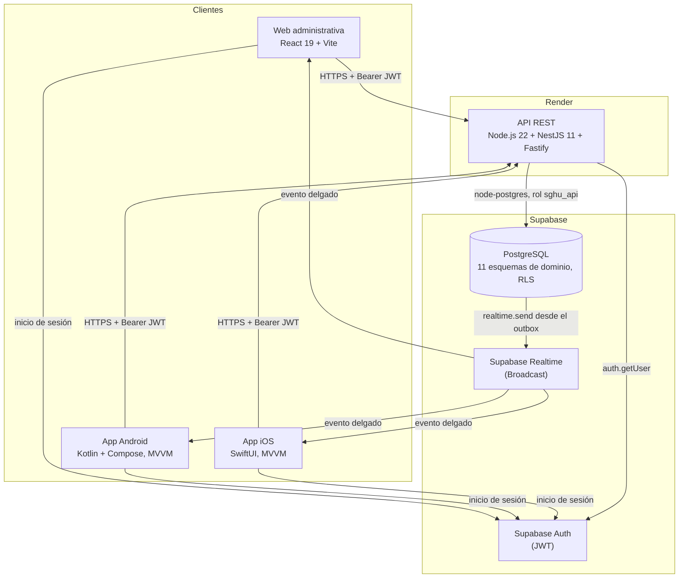
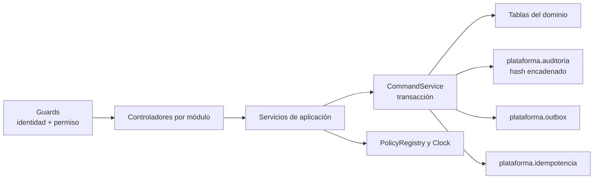
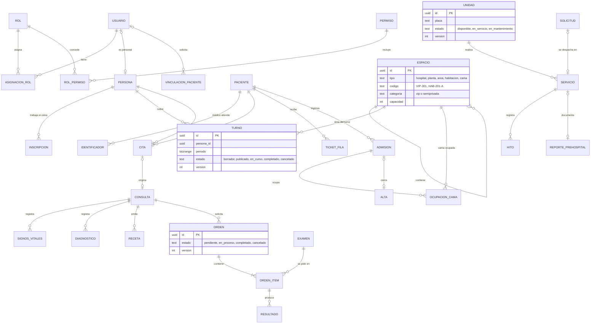
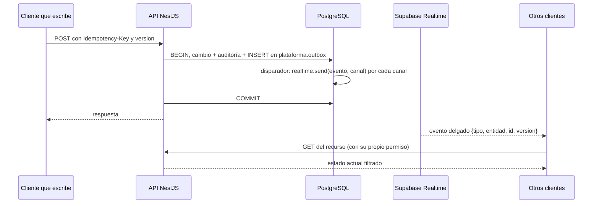
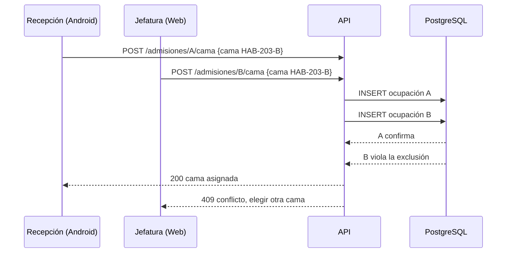
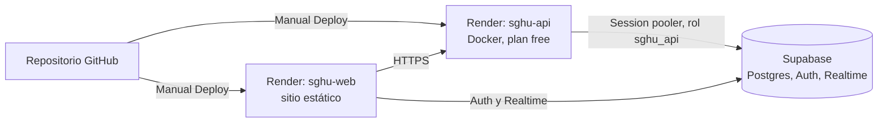

# Documento de Arquitectura · CLIMESA (SGHU)

Sistema de Gestión Hospitalaria Universitaria · Proyecto final de Desarrollo de Aplicaciones Móviles Avanzadas (DAMA) · Entrega y defensa: 21 de noviembre de 2026.

> Todos los datos del sistema, de las pruebas y de este documento son ficticios.
>
> Este documento describe el código de la rama `feat/r-docs-entrega`, rebasada sobre `main` tras la fusión del PR #68 (commit `c762fd2`, 13-nov-2026). Cada afirmación remite a un archivo del repositorio y se verificó contra los controladores (`api/src/**`), el contrato (`contrato/openapi.json`), el menú web (`web/src/features/shell.tsx`), las secciones Android (`domain/AuthModels.kt`, campo `ready`) y `ios/README.md`. Lo que no existe se marca **parcial** o **pendiente**; lo que existe pero no se probó en un dispositivo real se dice.

## Contenido

1. Contexto y alcance
2. Diseño UX/UI (Figma y sistema de diseño)
3. Arquitectura de software
4. Módulos y estado por módulo
5. Clientes (web, Android, iOS)
6. Modelo de datos
7. Seguridad y control de acceso por rol (RBAC)
8. Política de privacidad de datos
9. Tiempo real
10. Idempotencia y concurrencia optimista
11. Despliegue
12. Integración continua
13. Calidad y pruebas
14. Decisiones de arquitectura
15. Limitaciones conocidas
- Anexo A. Endpoints y permiso requerido
- Anexo B. Matriz completa de permisos por rol

---

## 1. Contexto y alcance

El curso pide un ecosistema multiplataforma para un hospital universitario: app iOS nativa (médicos y pacientes), app Android nativa (recepción, asistencia, enfermería y médicos) y un panel web administrativo (administración y jefatura de operaciones). Las reglas de negocio del curso son:

| Regla del curso | Cómo se modela en CLIMESA |
|---|---|
| 3.ª planta: 5 habitaciones VIP individuales (VIP-301 a VIP-305) | `supabase/seed.sql`: área `P3-VIP`, habitaciones `VIP-301`…`VIP-305`, categoría `vip`, capacidad 1 |
| 2.ª planta: 6 habitaciones semiprivadas de 2 camas (HAB-201 a HAB-206), 12 camas | `supabase/seed.sql`: área `P2-HOS`, habitaciones `HAB-201`…`HAB-206`, categoría `semiprivada`, capacidad 2 |
| Sin sobrecupo ni doble asignación de camas | Disparador de capacidad en `infra.espacio` y `EXCLUDE USING gist` sobre la ocupación de cama (sección 6.3) |
| Turnos del personal | Esquema `personal` (`persona`, `inscripcion`, `turno`) con exclusión de traslapes |
| Consulta general y laboratorio con estados Pendiente, En Proceso, Completado | `laboratorio.orden.estado` admite `pendiente`, `en_proceso`, `completado` y `cancelado` |
| Información pública frente a privada | Política de la sección 8; `GET /publico/*` sin sesión y la pantalla pública de la web (`/publico`, `web/src/features/public-screen.tsx`) |
| Una sola ambulancia con estados Disponible, En Servicio, En Mantenimiento | `ambulancia.unidad.estado` con esos tres valores; la semilla crea una única unidad. Solicitud, despacho, hitos, reporte prehospital y bitácora en `/ambulancia/*` (sección 4) |

Roles del sistema (10): ADM (administración técnica), JOP (jefatura de operaciones), REC (recepción), AST (asistencia), ENF (enfermería), MED (médico), LAB (laboratorio), PAR (paramédico), DPD (delegado de protección de datos) y PAC (paciente). El catálogo está en `docs/arquitectura/datos/permisos.csv` (78 permisos).

## 2. Diseño UX/UI (Figma y sistema de diseño)

| Entregable | Ubicación | Estado |
|---|---|---|
| Archivo de Figma | https://www.figma.com/design/bHJjbgi64I0p0Bnw8nho8e | Versión anterior. **No está sincronizado** con las pantallas actuales (`README.md`, sección "Figma y alcance") |
| Sistema de diseño (paleta clara y oscura, tipografía, estados de componentes) | `docs/diseno/claude-design/01-sistema-claro.html`, `02-sistema-oscuro.html`, `04-estados-y-avisos.html` | En HTML, versionado en el repositorio |
| Prototipos por rol y plataforma | `docs/diseno/claude-design/05-…` a `19-…` (web por rol y Android por rol) | En HTML |
| Inventario de pantallas (códigos W, A, I) | `docs/diseno/inventario-pantallas.md`, `docs/arquitectura/datos/pantallas.csv` | Generado por `tools/` |

Decisiones de diseño registradas: D-068 (tipografía Atkinson Hyperlegible Next y Mono, íconos Material Symbols Rounded), D-070 (azul CLIMESA `#0043B2`; cada estado con tono, forma, ícono y palabra), D-071 (avisos en tres niveles), D-072 (atajos de teclado que se pueden apagar, WCAG 2.1.4) y D-073 (ocho estados por pantalla). Fuente: `docs/decisiones/registro-decisiones.md`.

La web incluye una galería de revisión sin credenciales (`/work-preview.html` y `/design-preview.html` en el servidor de desarrollo) con los mismos componentes del producto y datos ficticios en memoria.

## 3. Arquitectura de software

### 3.1 Vista general

CLIMESA es un **monolito modular** (ADR-0001): una sola API propia sobre Supabase. Supabase aporta PostgreSQL, Auth (inicio de sesión) y Realtime (difusión de eventos). Los clientes **nunca** consultan tablas de Supabase directamente: solo usan Supabase para iniciar sesión y escuchar eventos. Toda escritura y toda lectura de datos de negocio pasa por la API (`AGENTS.md`, regla 4).

### 3.2 Flujo de una petición

1. El cliente obtiene un JWT de Supabase Auth.
2. La API valida el token con `auth.getUser` (`api/src/auth/supabase-auth.guard.ts`) y carga desde la base la cuenta, sus roles y sus permisos vigentes. Ningún permiso se toma de `user_metadata`.
3. El guard de permisos (`api/src/auth/permission.guard.ts`) compara el permiso que exige el endpoint (`@RequirePermission(...)`) con los permisos de la cuenta.
4. El servicio de aplicación ejecuta la operación dentro de una transacción con `SET LOCAL ROLE sghu_api` (`api/src/platform/database.service.ts`).
5. Las escrituras pasan por `CommandService`: idempotencia, cambio de datos, auditoría encadenada y evento en el outbox, todo en la misma transacción (sección 10).
6. Los errores se devuelven como `application/problem+json` con un código y un identificador de solicitud.

### 3.3 Estructura interna de la API

Carpetas de `api/src`: `auth`, `users`, `accounts` (vinculación de cuentas), `patients`, `operations` (personal, turnos, espacios, camas, inicio y eventos), `attention` (citas, fila, consulta, expediente e historial clínico), `laboratory`, `hospitalization`, `inventory`, `ambulance`, `privacy` (auditoría, "quién vio mi expediente"), `public` (información pública y avisos), `metrics`, `health`, `config` (cabeceras de seguridad y límite de tasa), `platform` y `supabase`. La arquitectura de módulos se comprueba con `api/tests/architecture.spec.ts`.

## 4. Módulos y estado por módulo

Estados: **Implementado** (API y al menos un cliente), **Parcial** (existe una parte; se indica cuál falta) y **Pendiente** (no existe). En Android, "pendiente" significa `ready=false` en `AndroidSection`: la sección muestra "Próxima entrega".

| Módulo | API | Web | Android | iOS | Estado |
|---|---|---|---|---|---|
| Identidad, sesión y perfil | `/auth/me`, `/inicio`, `/eventos` | Ingreso, registro, recuperar y restablecer contraseña, aceptar invitación | Ingreso; un 401 renueva la sesión una vez y, si falla, vuelve al ingreso | I01, I02, I12 | Implementado |
| Usuarios, invitaciones y roles | `/usuarios/*` | Sí | — | — | Implementado |
| Pacientes (búsqueda, registro, provisionales, duplicados, ficha filtrada) | `/pacientes/*`, `/me/paciente` | Sí | Pacientes (REC), Paciente sin identidad (PAR) | Expediente (MED, I22) | Implementado |
| Personal e inscripciones | `/personal/*` | Sí | — | — | Implementado |
| Turnos del personal | `/turnos/*` | Sí | Mis turnos | Mis turnos (I26) | Implementado |
| Edificio y espacios | `/espacios/*` | Sí | — | — | Implementado |
| Camas (tablero, bloqueo, limpieza) | `/camas/*` | Sí | Tablero de camas | — | Implementado. Limpieza en Android pendiente (A52) |
| Citas de 20 minutos | `/citas/*` | Sí | Mis citas (PAC) | Mis citas (I06) | Implementado. Citas de recepción en Android pendiente (A32) |
| Fila del día | `/fila/*` | Sí | Emitir número, Mi turno, Mi consultorio | Mi turno (I05), Mi día (I20) | Implementado |
| Consulta general (borrador, signos, diagnósticos CIE-10, receta, firma) | `/consultas/*` | Mi consultorio | Mi día, Consulta, Expediente. Signos vitales (A41) pendiente | Mi día, Consulta (I20, I21) | Implementado |
| Laboratorio (orden, muestra con doble identificación, resultados, validación, revisión) | `/laboratorio/*`, `/me/laboratorio` | Sí | Sí | Mis exámenes (I07), Resultados por revisar (I23) | Implementado |
| Hospitalización (admisión, cama, traslado, notas, alta, salida) | `/admisiones/*`, `/ocupaciones/{id}/traslado` | Sí, incluido el traslado | Admisión y cama, Mi planta, Mis hospitalizados, Paciente hospitalizado; sin traslado | Mis hospitalizados (I24) | Implementado. Notas de enfermería (`POST /admisiones/{id}/notas-enfermeria`): solo API |
| Inventario (existencias, movimientos, artículos, alerta de mínimo) | `/inventario/*` | Sí | Consumo de insumos | — | Implementado |
| Ambulancia (estado, mantenimiento) | `GET /ambulancia`, `POST /ambulancia/mantenimiento` | Sí | Unidad (A70) | — | Implementado |
| Ambulancia (solicitud, despacho, hitos, ubicación, reporte prehospital, bitácora) | `/ambulancia/solicitudes`, `/servicios`, `/ubicacion`, `/bitacora` | Ambulancia y Bitácora de ambulancia | Pedir ambulancia (PAC), Despacho (REC), Servicio, Reporte prehospital, Paciente sin identidad, Mi bitácora (PAR), recepción (ENF, MED) | Pedir ambulancia (I09), Llegada de ambulancia (I25) | Implementado |
| Información pública (ocupación, médicos de turno, fila, avisos) | `/publico/*` sin sesión y con límite de tasa; `POST /avisos` | Pantalla `/publico`; Avisos (JOP) | Hospital (A10) | Información del hospital (I10) | Implementado |
| Métricas | `/metricas/tablero`, `/metricas/{indicador}` | Métricas (ADM, JOP, DPD) | — | — | Implementado (solo web) |
| Auditoría (búsqueda y verificación de la cadena de hash) | `GET /auditoria` (persona, paciente, acción, fechas), `POST /auditoria/verificacion` | Auditoría (DPD) | — | — | Implementado |
| "Quién vio mi expediente" | `GET /me/accesos` | — | A11 | I11 | Implementado |
| Historial clínico completo | `GET /pacientes/{id}/historial` | Historial (`clinical-history.tsx`) | Mi historial (PAC), Expediente (MED) | Mi historial (I08), Expediente (I22) | Implementado |
| Vinculación de cuenta PAC con expediente | `POST /cuentas/vinculacion`, `/cuentas/vinculaciones/*` | Vinculaciones (REC) | Vincular expediente (PAC, A03). Vinculaciones de recepción (A33) pendiente | Vincular expediente (I03) | Implementado |
| Notificaciones push (FCM, APNs) | No | No | No | No | Pendiente |

Fuentes: controladores en `api/src/**/*.controller.ts`, menú web en `web/src/features/shell.tsx`, secciones Android en `android/app/src/main/java/sv/edu/catolica/climesa/domain/AuthModels.kt` (campo `ready`; pendientes: A32, A33, A41, A52) y tabla de pantallas de `ios/README.md`.

## 5. Clientes

### 5.1 Web administrativa (`web/`)

- React 19.1, TypeScript 5.7, Vite 6.2; pruebas con Vitest.
- El menú depende solo del permiso (`web/src/features/shell.tsx`): cada módulo declara el permiso que lo abre; nunca se pregunta por el rol.
- Tipos de la API generados desde `contrato/openapi.json` (`web/src/lib/generated/`).
- Tiempo real con Supabase Realtime en `web/src/lib/live.ts` (sección 9).
- Sesión del personal con cierre por inactividad a los 15 minutos (`docs/arquitectura/privacidad.md`, regla 6).
- Rutas sin sesión: `/publico`, `/registro`, `/recuperar`, `/restablecer` y `/aceptar-invitacion` (`web/src/App.tsx`). Las rutas internas usan `#/<módulo>`. Para que estas rutas funcionen en producción, `render.yaml` reescribe `/*` a `/index.html` y define las cabeceras de seguridad (CSP, HSTS); esa configuración se sincroniza a mano en Render (sección 11).
- ESLint 9 con `npm run lint` (`web/eslint.config.js`).

### 5.2 Android (`android/`)

- Kotlin 2.1.20, Jetpack Compose (BOM 2025.04.01) con Material 3, Hilt 2.57.1, corrutinas y `StateFlow`, OkHttp 4.12. `minSdk` 26, `targetSdk`/`compileSdk` 35. `applicationId` `sv.edu.catolica.climesa`.
- Patrón **MVVM**: pantallas Compose (`*Screen.kt`) que observan `ViewModel` con `StateFlow`; los ViewModel llaman a repositorios HTTP de forma asíncrona con corrutinas (`viewModelScope.launch`).
- Las secciones se habilitan por permiso (`AndroidSection` en `domain/AuthModels.kt`); las que no están listas muestran su estado pendiente.
- Tiempo real nativo con el mismo protocolo que la web: `data/realtime/OkHttpRealtimeSocket.kt`, `RealtimeRepository.kt`, `SharedRealtime.kt`. Al llegar un evento se vuelven a pedir los datos de la pantalla abierta; no hay sondeo.
- Fase 1: APK release firmado con las variables `CLIMESA_RELEASE_*` (sin ellas genera un APK sin firmar; ver `android/README.md`), 401 con una renovación y regreso al ingreso, cierre de sesión que descarta los ViewModels y una `Idempotency-Key` por intención del usuario (`SubmissionIntent`).
- La sesión se guarda cifrada con Android Keystore; los pacientes remotos no se guardan en disco.
- URL de la API: Debug usa `http://10.0.2.2:3000/api/v1` (emulador) salvo que `CLIMESA_API_BASE_URL` la sobrescriba; Release usa `https://sghu-api.onrender.com/api/v1` (`android/app/build.gradle.kts`).

### 5.3 iOS (`ios/`)

- SwiftUI con MVVM (`@Observable` y servicios `actor`), `URLSession` con `async/await` y Keychain (`WhenUnlockedThisDeviceOnly`). iOS 17+, Xcode 15+. Sin dependencias externas; el núcleo `Core/` es un Swift Package con pruebas (`swift test`).
- Roles Médico y Paciente. Las pestañas salen del perfil de `/auth/me` (`TabPolicy`); otro rol ve "Tu rol no usa esta aplicación". Pantallas I01 a I12 (PAC y comunes) e I20 a I26 (MED), con los endpoints de cada una en la tabla de `ios/README.md`.
- Tiempo real en `Core/Realtime` con el mismo protocolo Phoenix que web y Android; tras una caída se hace una sola consulta `GET /eventos?after=`.
- Un 401 borra la sesión y vuelve al ingreso; la sesión se cierra al volver tras cinco minutos en segundo plano.
- **Estado.** El workflow `ios.yml` (macOS 15) corre `swift test` y compila para simulador sin firma. **No** se probó en simulador ni en un iPhone con cuentas MED y PAC, y no se entrega IPA: instalar en un dispositivo o publicar en TestFlight requiere firmar con una cuenta de Apple. La paridad con Android no es total: faltan seguimiento y cancelación de la ambulancia del paciente, buscador CIE-10 y push (`docs/preguntas-abiertas.md`).

## 6. Modelo de datos

### 6.1 Esquemas por dominio

La base tiene **11 esquemas de dominio** y **66 tablas**, definidas en 28 archivos de `supabase/migrations/` (incluida la semilla de acceso generada). Además existe el esquema `metricas`, solo con vistas (`v_ocupacion_por_planta`, `v_laboratorio_por_estado`). Cada módulo escribe solo en su esquema; entre esquemas se usan llaves lógicas y vistas de solo lectura con prefijo `v_` (`docs/arquitectura/modelo-datos.md`).

| Esquema | Tablas |
|---|---|
| `plataforma` | `outbox`, `inbox`, `idempotencia`, `auditoria`, `politica` |
| `acceso` | `usuario`, `rol`, `permiso`, `rol_permiso`, `asignacion_rol`, `invitacion`, `administrador_principal`, `vinculacion_paciente`, `acceso_excepcional`, `dispositivo_push` |
| `pacientes` | `paciente`, `identificador`, `tipo_identificador`, `historial_demografico`, `busqueda_registro`, `caso_duplicado` |
| `personal` | `persona`, `inscripcion`, `turno` |
| `infra` | `espacio` (árbol hospital → planta → área → habitación → cama), `bloqueo_cama`, `limpieza_cama`, `equipo`, `tipo_equipo` |
| `atencion` | `cita`, `ticket_fila`, `contador_fila`, `consulta`, `signos_vitales`, `diagnostico`, `cie`, `receta`, `receta_item`, `addendum`, `relacion_atencion` |
| `laboratorio` | `examen`, `examen_componente`, `rango_referencia`, `orden`, `orden_item`, `resultado`, `resultado_historial` |
| `hospitalizacion` | `admision`, `reserva_cama`, `ocupacion_cama`, `traslado`, `nota_enfermeria`, `alta` |
| `ambulancia` | `unidad`, `cambio_estado`, `solicitud`, `servicio`, `tripulacion`, `hito`, `reporte_prehospital`, `ubicacion` |
| `inventario` | `articulo`, `lote`, `existencia`, `movimiento` |
| `publico` | `aviso` |

Una tabla sigue sin API: `atencion.addendum`. Una consulta firmada no se edita y no hay endpoint de corrección por addendum. El resto de las tablas de ambulancia y avisos ya tienen endpoints (sección 4). `acceso.acceso_excepcional` conserva las solicitudes históricas del módulo retirado en la ronda 1 y ya no tiene API.

### 6.2 Diagrama entidad-relación (entidades pedidas por el curso)

Las relaciones entre esquemas distintos (por ejemplo `CITA` → `PACIENTE`) son llaves lógicas, no llaves foráneas cruzadas. El diagrama completo por esquema está en `docs/arquitectura/modelo-datos.md`.

### 6.3 Invariantes garantizadas por PostgreSQL

Las reglas concurrentes no dependen del cliente (`AGENTS.md`, regla 5):

| Invariante | Mecanismo (archivo) |
|---|---|
| Una cama, un paciente a la vez | `EXCLUDE USING gist (cama_id with =, periodo with &&)` en `hospitalizacion.ocupacion_cama` (`20261017000800_hospitalizacion.sql`) |
| Una habitación no supera su capacidad | Disparador `infra.validar_capacidad` sobre `infra.espacio` (`20261017000400_infra.sql`) |
| Una persona no tiene turnos traslapados | `EXCLUDE USING gist (persona_id with =, periodo with &&)` donde el estado no es `cancelado` (`20261017000500_personal.sql`) |
| Un médico no tiene dos citas a la vez | `EXCLUDE USING gist (medico_id with =, horario with &&)` en citas solicitadas o confirmadas (`20261017000600_atencion.sql`) |
| Un paciente no tiene dos citas a la vez | Exclusión sobre `paciente_id` y `horario` (`20261114000200_integridad_citas_consulta.sql`) |
| Un número de fila activo por paciente, servicio y día | Índice único (`20261114000300_ticket_activo_unico.sql`) |
| Un servicio activo por ambulancia | Índice único parcial `servicio_activo_unico` donde `finalizado_en is null` (`20261017000900_ambulancia.sql`) |
| Hitos de ambulancia en orden | Validación de la secuencia `salida → en_escena → trasladando → en_hospital → finalizado` (`20261017000900_ambulancia.sql`; despacho en `20261115001000_ambulancia_despacho.sql`) |
| Una vinculación pendiente por cuenta | Restricciones de `20261115003000_vinculacion_invariantes.sql` |
| Auditoría inmutable | El rol de la API solo tiene `INSERT` y `SELECT` sobre la auditoría; cada fila guarda el hash de la anterior |

Las pruebas `supabase/pruebas/01_invariantes.sql` y `02_concurrencia.sh` comprueban estas reglas sobre PostgreSQL nativo.

## 7. Seguridad y control de acceso por rol (RBAC)

### 7.1 Capas

| Capa | Control | Evidencia |
|---|---|---|
| Transporte | HTTPS en Render; JWT de Supabase con renovación | `render.yaml`, `docs/desarrollo/despliegue-render.md` |
| Identidad | La API valida cada token con `auth.getUser` y carga cuenta, roles y permisos desde la base | `api/src/auth/supabase-auth.guard.ts`, `access.service.ts` |
| Autorización | Un permiso por endpoint, por nombre de permiso (`camas.asignar`), nunca por rol | `api/src/auth/permission.guard.ts`; pruebas `sin-roles-en-codigo.spec.ts`, `matriz-rbac.spec.ts` |
| Contexto | Además del permiso, algunas lecturas exigen relación de atención, área con turno en curso o ser el dueño (`propio`, `relacion`, `area` en la matriz) | `docs/arquitectura/datos/permisos.csv`; `20261029000100_acceso_contextos_ficha.sql` |
| Base de datos | RLS activado en todas las tablas de negocio; sin políticas para `anon` ni `authenticated` (acceso directo denegado); la API usa el rol `sghu_api` con permisos mínimos | `supabase/migrations/20261017001200_seguridad.sql` |
| Tiempo real | Canales privados autorizados contra el estado actual de la base; mensajes sin datos personales | `20261017000100_plataforma.sql`, ADR-0005 |
| Secretos | `service_role`/clave secreta y `DATABASE_URL` solo en el servidor; los clientes usan la clave publicable | `AGENTS.md` regla 3, `render.yaml` (`sync: false`) |
| Cabeceras y límite de tasa | `helmet` y un límite por IP en la API (`api/src/config/security.ts`); la información pública tiene su propio límite (`api/src/public/rate-limit.guard.ts`). La web define CSP y HSTS en `render.yaml` | `api/src/config/security.ts`, `render.yaml` |
| Protección del último administrador | La API y disparadores SQL impiden dejar el sistema sin ADM activo | `docs/arquitectura/arquitectura.md` |

### 7.2 Matriz resumida por rol

Resumen de qué puede ver (V) y modificar (M) cada rol, según `docs/arquitectura/datos/permisos.csv`. El detalle completo por permiso está en el Anexo B y el permiso de cada endpoint en el Anexo A.

| Área | ADM | JOP | REC | AST | ENF | MED | LAB | PAR | DPD | PAC |
|---|---|---|---|---|---|---|---|---|---|---|
| Usuarios y roles | V/M | · | · | · | · | · | · | · | V | · |
| Personal | V/M | V | · | · | · | · | · | · | · | · |
| Turnos | V | V/M | V | V | V | V | V | V | · | · |
| Edificio y espacios | V/M | V | V | V | V | V | · | · | · | · |
| Camas (tablero, asignación, traslado, bloqueo, limpieza) | · | V/M | V/M | · | V/M (área) | V | · | · | · | V (propio) |
| Pacientes (ficha y registro) | · | V/M (duplicados) | V/M | V (área) | V/M (área; provisional) | V (relación) | V (orden) | V/M (relación; provisional) | · | V (propio) |
| Citas | · | V | V/M | V | · | V (propias) | · | · | · | V/M (propias) |
| Fila del día | · | V | V/M | V/M | · | V/M | · | · | · | V (propio) |
| Consulta, diagnósticos, recetas, signos | · | · | · | M (signos) | V (relación); M (signos) | V/M (relación) | · | M (signos) | · | V (propio, revisado) |
| Laboratorio | M (catálogo) | · | · | · | V (relación) | V/M (ordenar, revisar) | V/M (procesar, validar) | · | · | V (propio, revisado) |
| Hospitalización | · | V/M | V/M | · | V/M (área) | V/M (relación; indicar, alta) | · | · | · | V (propio) |
| Inventario | M (configurar) | V/M | · | · | V/M (consumo) | · | V/M (reactivos) | · | · | · |
| Ambulancia: estado | · | V | V | · | · | V | · | V | · | · |
| Ambulancia: mantenimiento | · | M | · | · | · | · | · | · | · | · |
| Auditoría (metadatos, búsqueda, verificación de cadena) | · | · | · | · | · | · | · | · | V | · |
| Vinculación de cuenta con expediente | · | · | M (aprueba) | · | · | · | · | · | · | M (solicita, propio) |
| "Quién vio mi expediente" | · | · | · | · | · | · | · | · | · | V (propio) |
| Ambulancia: solicitud | · | · | M | · | · | · | · | · | · | M |
| Ambulancia: despacho | · | M | M | · | · | · | · | · | · | · |
| Ambulancia: hitos, ubicación y prehospital (registro) | · | · | · | · | · | · | · | M | · | · |
| Ambulancia: recepción prehospital | · | V | V | · | V | V | · | · | · | · |
| Ambulancia: bitácora | · | V | V | · | · | · | · | V | V | · |
| Avisos públicos | · | M | · | · | · | · | · | · | · | · |
| Métricas | V | V | · | · | · | · | · | · | V | · |

Contextos: "área" significa con turno en curso en el área del paciente; "relación", con relación de atención; "orden", solo pacientes con orden de laboratorio; "propio", solo lo del propio paciente.

La tabla es una lectura humana del CSV; si difiere, manda `permisos.csv`, que es la fuente que usan la base (`20261017000210_acceso_semilla.sql`, generada) y las pruebas.

## 8. Política de privacidad de datos

Documento completo: `docs/arquitectura/privacidad.md` (base: LPDP de El Salvador, Decreto 144 de 2024, y Norma Técnica del Expediente Clínico). Resumen:

### 8.1 Clases de información

| Clase | Quién la ve | Ejemplos |
|---|---|---|
| **Pública** | Cualquiera, sin sesión | Ocupación general por planta y tipo (números, no camas), médicos de turno, avisos generales, números de fila llamados sin nombre |
| **Interna** | Personal con sesión, según permiso | Estado de cada cama sin ocupante, estado de la ambulancia, turnos, inventario |
| **Personal** | Paciente dueño, personal que lo atiende o registra, administración autorizada | Nombre, DUI, fecha de nacimiento, teléfono, dirección, cama asignada, citas |
| **Clínica (sensible)** | Paciente dueño (lo revisado o firmado), médico tratante, enfermería del área, laboratorio en lo que procesa | Consultas, diagnósticos, recetas, signos vitales, órdenes y resultados, notas de enfermería, alta |

"Administración autorizada" (D-031): ADM y JOP ven los datos personales necesarios para operar (cama asignada, admisión), **nunca** lo clínico por su rol. Sin relación de atención no hay lectura clínica (el módulo de acceso excepcional se retiró en la ronda 1); toda lectura queda auditada y el paciente la ve en "Quién vio mi expediente" (`GET /me/accesos`: fecha, rol y motivo, sin nombres del personal).

### 8.2 Campos públicos y privados del expediente

| Campo | Clase | Público | Quién lo ve con sesión (resumen) |
|---|---|---|---|
| Número de expediente, nombres | Personal | No | PAC dueño, REC, AST, ENF, MED, LAB, JOP; PAR durante el servicio |
| DUI y otros documentos | Personal | No | PAC dueño, REC, MED |
| Teléfono, correo, dirección | Personal | No | PAC dueño, REC, MED; PAR solo la dirección del servicio |
| Habitación y cama asignada | Personal | Solo el agregado de ocupación | PAC dueño, REC, ENF del área, MED, JOP |
| Citas y número de fila | Personal | Solo el número, sin nombre | PAC dueño, REC, AST, MED (propias) |
| Signos vitales, motivo, diagnósticos, recetas | Clínica | No | PAC dueño (firmado), ENF del área, MED; AST y PAR al registrar signos |
| Estado de una orden de laboratorio | Clínica | No | PAC dueño (siempre), ENF del área, MED, LAB |
| Valores de resultados | Clínica | No | PAC dueño **solo tras la revisión del médico** (D-040), ENF del área, MED, LAB |

### 8.3 Reglas técnicas implementadas

1. La API filtra campos según permiso y contexto antes de responder; el cliente no recibe un campo para ocultarlo (`api/tests/patients-fichas.spec.ts`).
2. Los eventos de tiempo real no llevan datos personales ni clínicos. Un paciente sin expediente vinculado recibe una fila vacía; los eventos de fila y de consulta de un paciente no llegan al canal general `rol:PAC`, y un resultado crítico no llega al paciente antes de la revisión médica (`api/tests/fase0-privacidad-eventos.spec.ts`).
3. Las lecturas de detalle clínico, agenda, citas y fila quedan auditadas (`api/tests/fase0-inscripcion-lecturas.spec.ts`); las búsquedas de pacientes guardan una huella del texto buscado, no el texto (`api/src/patients/patients.service.ts`).
4. El paciente ve el estado de sus órdenes siempre, y los valores solo después de la revisión médica.
5. Cierre de sesión por inactividad: 15 minutos en web; 5 minutos en segundo plano en móvil.
6. Los clientes no guardan datos clínicos en disco.
7. La información pública (`/publico/*`) no requiere sesión, no lleva datos personales y tiene límite de tasa por IP; la web y las apps la muestran como "Hospital".
8. `POST /auditoria/verificacion` recalcula la cadena de hash y permite al DPD comprobar que la auditoría no se alteró.

## 9. Tiempo real

Ningún cliente recarga ni consulta cada cierto tiempo (`AGENTS.md`, regla 9; ADR-0005; D-060).

- El evento se escribe en `plataforma.outbox` dentro de la misma transacción; si la transacción falla, no hay evento. Un disparador llama a `realtime.send` para cada canal (`supabase/migrations/20261017000100_plataforma.sql`).
- Canales: `rol:<código>`, `usuario:<id>`, `area:<espacio>`, `paciente:<id>`, `ambulancia` (privados) y `publico`. Los canales de cada evento se derivan del catálogo de permisos al emitirlo, no de listas de roles en el código (`api/tests/tiempo-real-canales.spec.ts`).
- El cliente no confía en el contenido del evento: invalida y vuelve a pedir lo que le toca con su permiso.
- Recuperación: tras una caída del canal o al volver la red, el cliente hace **una** consulta a `GET /eventos?after=<cursor>` (hasta 200 eventos) y vuelve a pedir sus vistas. No hay reintento por reloj.
- Catálogo de eventos: `docs/arquitectura/tiempo-real.md`. El catálogo incluye los eventos de ambulancia, vinculación (`vinculacion.resuelta`), accesos, avisos, métricas (`metricas.recalculadas`) e inventario bajo el mínimo (`inventario.bajo_minimo`). Web, Android e iOS usan el mismo protocolo Phoenix de Supabase Realtime.

## 10. Idempotencia y concurrencia optimista

- **Idempotencia.** Toda escritura lleva la cabecera `Idempotency-Key`. La clave se guarda en `plataforma.idempotencia` por actor y operación, junto con el hash del cuerpo. Repetir la misma clave con el mismo cuerpo devuelve la respuesta guardada; con otro cuerpo devuelve 409.
- **Versión optimista.** Las tablas editables tienen `version int`. El cliente envía la versión que leyó; si otra persona la cambió antes, la API responde 409 y el cliente vuelve a cargar. Hospitalización envía la versión en web (commit `39bd23b`), en el alta de Android (`575d998`) y en toda escritura de iOS; tras un `version_conflicto` la pantalla vuelve a pedir el registro.
- **Nada clínico se borra.** Una consulta firmada no se edita (`20261114000200_integridad_citas_consulta.sql`); las correcciones de resultados de laboratorio exigen motivo y guardan el valor anterior en `laboratorio.resultado_historial`.
- **Una clave por intención.** Los tres clientes generan la `Idempotency-Key` por acción del usuario y la reutilizan solo en el reintento de esa misma acción (`SubmissionIntent` en Android e iOS, `web/src/features/intent.ts`).
- **Auditoría encadenada.** Cada fila de `plataforma.auditoria` incluye el hash de la anterior (SHA-256) y el JSON canónico del evento.

## 11. Despliegue

| Pieza | Dirección | Configuración |
|---|---|---|
| Web | https://sghu-web.onrender.com | `render.yaml`: `npm ci && npm run build`, publica `dist`, reescribe `/* → /index.html` |
| API | https://sghu-api.onrender.com/api/v1 | `render.yaml`: Docker (`api/Dockerfile`), health check `/salud` |
| Base, Auth y Realtime | Proyecto Supabase "Gestion hospitalaria universitaria (Climesa)" | Migraciones aplicadas a mano en orden de fecha (`docs/desarrollo/ges-15-supabase-remoto.md`); no se usa `supabase db push` |

- `autoDeploy: false` en ambos servicios: el despliegue es manual desde el panel de Render.
- **Pendiente de la dueña del proyecto (Render).** `render.yaml` ya contiene la reescritura `/*` → `/index.html` y las cabeceras de seguridad, pero Render no las aplica solo: hay que sincronizarlas en el panel (Blueprint o reglas del sitio estático). Mientras no se haga, la producción responde 404 en `/publico`, `/recuperar`, `/restablecer`, `/registro` y `/aceptar-invitacion`.
- **Base de datos de producción.** Todas las migraciones hasta `20261116002000_fase1_contrato_api.sql` están aplicadas, salvo `20261114000300_ticket_activo_unico.sql`, que se aplica pasada la medianoche local del 14-nov (depende de la fecha). Se aplican a mano; no se usa `supabase db push`.
- Las variables secretas (`SUPABASE_SECRET_KEY`, `DATABASE_URL`) se escriben a mano en Render (`sync: false`).
- La API se conecta por el *Session pooler* de Supabase porque la conexión directa es solo IPv6.
- El plan gratuito duerme la API tras 15 minutos sin tráfico; la primera llamada tarda cerca de un minuto (`docs/desarrollo/despliegue-render.md`).

## 12. Integración continua

Un workflow de GitHub Actions por componente, que solo corre cuando cambian sus rutas (`.github/workflows/`):

| Workflow | Qué ejecuta |
|---|---|
| `api.yml` | Node 22: instalación, ESLint, pruebas Jest y compilación de la API |
| `web.yml` | Node 22: instalación, ESLint, pruebas Vitest y compilación de la web |
| `android.yml` | JDK 17: `./gradlew testDebugUnitTest assembleDebug` |
| `ios.yml` | macOS 15: `swift test` y `xcodebuild` para simulador |
| `supabase.yml` | PostgreSQL en Docker: todas las migraciones, `01_invariantes.sql` y `02_concurrencia.sh` |
| `docs.yml` | Python: `generar_docs.py`, `progreso.py` y `backlog.py` con `--verificar` |

El despliegue no está conectado a CI: no hay un gate que impida desplegar un commit con pruebas fallidas.

## 13. Calidad y pruebas

| Componente | Pruebas en esta rama | Herramienta |
|---|---|---|
| API | 43 archivos `*.spec.ts` en `api/tests/` (pipeline HTTP, RBAC, privacidad, tiempo real, módulos clínicos, ambulancia, público, métricas, vinculación) | Jest sobre PostgreSQL WASM (PGlite) con todas las migraciones |
| Web | 33 archivos de prueba en `web/src` | Vitest |
| Android | 38 archivos de prueba en `android/app/src/test` | JUnit (`testDebugUnitTest`) |
| iOS | 6 archivos en `ios/Tests` (contrato, reglas, tiempo real); el workflow `ios.yml` ejecuta `swift test` y compila para simulador | XCTest (no ejecutado en este entorno) |
| Base de datos | `supabase/pruebas/01_invariantes.sql`, `02_concurrencia.sh` | PostgreSQL nativo en Docker |
| Documentación | `tools/progreso.py --verificar`, `tools/generar_docs.py --verificar` | Python |

Última ejecución registrada (`docs/ESTADO_DESARROLLO_2026-11-13.md`, anterior a la integración de las fases 1): API 25 suites y 273 pruebas en verde; web 13 archivos y 143 pruebas en verde. Los conteos de esta sección son de archivos y se obtuvieron contando los archivos del repositorio; este documento no vuelve a ejecutar las pruebas. La CI de cada pull request las ejecuta.

PGlite usa una sola conexión y no demuestra carreras entre sesiones; esas carreras se cubren con `02_concurrencia.sh` sobre PostgreSQL nativo.

## 14. Decisiones de arquitectura

| ADR | Decisión |
|---|---|
| ADR-0001 | Monolito modular con API propia sobre Supabase |
| ADR-0002 | Repositorio único (monorepo) y estructura |
| ADR-0003 | Clientes nativos con patrón MVVM |
| ADR-0004 | Autenticación con Supabase Auth, autorización y acceso a datos en la API |
| ADR-0005 | Tiempo real con outbox y Broadcast; notificaciones |
| ADR-0006 | Migraciones, semillas y entornos |
| ADR-0007 | Concurrencia y recursión (árbol de espacios y de exámenes) |
| ADR-0008 | Despliegue y perfiles |
| ADR-024 | Backend oficial en Node.js + NestJS (reemplaza el diseño anterior en .NET) |

Archivos: `docs/decisiones/adr/ADR-0001-…` a `ADR-0008-…` y `docs/decisiones/ADR-024-backend-nodejs.md`. Las decisiones puntuales `D-001` a `D-081` están en `docs/decisiones/registro-decisiones.md`; en particular D-059 (estados de laboratorio), D-060 (tiempo real), D-061 (autenticación), D-062 (recursión visible), D-063 (concurrencia demostrable) y D-064 (despliegue).

## 15. Limitaciones conocidas

1. **Despliegue manual y configuración de Render sin sincronizar.** Render no despliega solo ni espera a CI. Hasta que la dueña sincronice `render.yaml` (reescritura y cabeceras), producción da 404 en `/publico`, `/recuperar`, `/restablecer`, `/registro` y `/aceptar-invitacion`. Las migraciones de la nube se aplican a mano; `20261114000300` queda para después de la medianoche local del 14-nov.
2. **Inicio de sesión de prueba.** Si se fusiona el selector temporal de rol (`docs/operacion/login-de-prueba.md`), debe desactivarse antes de la entrega.
3. **iOS sin probar en dispositivo.** Compila y pasa `swift test` en CI, pero no se ejecutó en simulador ni iPhone con cuentas reales; no hay IPA ni TestFlight.
4. **Sin notificaciones push.** FCM y APNs no están construidos; los cambios llegan solo con la app abierta (Realtime).
5. **Pantallas Android pendientes.** Citas y Vinculaciones de recepción, Signos vitales (AST y ENF) y Limpieza de camas (`ready=false`); la web cubre esas funciones. Traslado de cama y notas de enfermería no tienen pantalla móvil.
6. **Addendum.** `atencion.addendum` existe sin endpoint; una consulta firmada no se corrige.
7. **Figma desactualizado.** El sistema de diseño vigente está en HTML dentro del repositorio.
8. **Plan gratuito de Render.** La API duerme tras 15 minutos sin tráfico.
9. **Cursor de recuperación.** Un evento de una transacción lenta puede quedar por debajo del cursor; se mitiga porque el cliente vuelve a pedir todas sus vistas al reconectar (`docs/arquitectura/tiempo-real.md`).
10. **Pruebas contra Supabase real.** Las pruebas de API usan PGlite con identidad simulada; no sustituyen el login, el correo y la concurrencia multisesión en la nube.

---

## Anexo A. Endpoints y permiso requerido

Generado desde `contrato/openapi.json` (campo `x-permiso` de cada operación): 108 operaciones bajo `/api/v1`. Cuando se listan varios permisos, basta con tener uno. "Sin sesión" son `/health`, `/salud` y `/publico/*`. Toda escritura exige `Idempotency-Key` y, si cambia un registro existente, su `version`. Los errores son `application/problem+json`. La documentación interactiva está en `/api/v1/docs`.

| Método | Ruta (`/api/v1`) | Permiso requerido | Qué hace |
|---|---|---|---|
| GET | `/pacientes` | `pacientes.buscar` | Buscar por nombre, fonética, DUI o expediente; devuelve campos mínimos |
| POST | `/pacientes` | `pacientes.registrar` | Registrar después de buscar; expediente y DUI exclusivos |
| POST | `/pacientes/busquedas` | `pacientes.buscar` | Buscar y obtener constancia de diez minutos, ligada a la cuenta y criterios |
| GET | `/pacientes/casos-duplicado` | `pacientes.gestionar_duplicados` | Casos abiertos de posible duplicado con los dos pacientes mínimos |
| GET | `/pacientes/{id}` | `pacientes.ver_ficha` | Ficha filtrada por rol y relación de atención |
| PATCH | `/pacientes/{id}` | `pacientes.editar_demograficos` | Corregir ficha con versión, motivo e historial |
| POST | `/pacientes/provisionales` | `pacientes.registrar_provisional` | Registrar identidad provisional sin inventar fecha exacta |
| POST | `/pacientes/{id}/estado` | `pacientes.editar_demograficos` | Inactivar o reactivar sin eliminar historial |
| GET | `/me/paciente` | `pacientes.ver_ficha` | Ficha del paciente autenticado |
| GET | `/auth/me` | `sesion.perfil` | Cuenta activa, roles, plataformas y permisos vigentes en la base |
| GET | `/usuarios` | `usuarios.ver` | Cuentas, roles, estado y vínculo con personal |
| POST | `/usuarios/invitaciones` | `usuarios.invitar` | Invitar paciente o personal con roles autorizados por el administrador |
| PATCH | `/usuarios/{id}/roles` | `usuarios.asignar_roles` | Cambiar roles; prohíbe autoasignación y protege el último administrador |
| PATCH | `/usuarios/{id}/estado` | `usuarios.desactivar` | Desactivar o reactivar; no desactiva al último administrador |
| GET | `/health` | sin sesión | Comprueba que la API está disponible |
| GET | `/salud` | sin sesión | Readiness: API y conexión PostgreSQL operativas |
| GET | `/inicio` | `sesion.perfil` | Resumen permitido para la cuenta actual |
| GET | `/personal` | `personal.ver` | Directorio de personal con o sin cuenta |
| POST | `/personal` | `personal.gestionar` | Registrar personal |
| PATCH | `/personal/{id}` | `personal.gestionar` | Editar o inactivar personal con versión y motivo |
| POST | `/personal/{id}/inscripciones` | `personal.gestionar` | Registrar inscripción profesional con vigencia, versión y motivo |
| GET | `/turnos` | `turnos.ver` | Consultar la planificación de turnos |
| POST | `/turnos` | `turnos.planificar` | Planificar turno con duración, traslapes y descanso |
| GET | `/turnos/mios` | `turnos.ver` | Turnos publicados de la persona vinculada a la cuenta |
| GET | `/turnos/cobertura` | `turnos.ver` | Huecos de cobertura por área y hora frente al mínimo vigente |
| POST | `/turnos/publicar` | `turnos.publicar` | Publicar los borradores de un rango; con huecos de cobertura advierte y registra quién publicó |
| PATCH | `/turnos/{id}` | `turnos.planificar` | Mover o cancelar turno con versión y motivo |
| GET | `/espacios` | `espacios.ver` | Árbol, rutas y disponibilidad recursiva por espacio |
| POST | `/espacios` | `espacios.configurar` | Crear espacio respetando árbol y capacidad |
| PATCH | `/espacios/{id}` | `espacios.configurar` | Editar espacio con versión, capacidad y ocupación |
| GET | `/camas` | `camas.ver_tablero` | Tablero con ocupante filtrado por permiso y área |
| POST | `/camas/{id}/bloquear` | `camas.bloquear` | Bloquear una cama libre con motivo y versión |
| POST | `/camas/{id}/desbloquear` | `camas.bloquear` | Retirar el bloqueo activo con versión y motivo |
| POST | `/camas/{id}/limpieza` | `camas.registrar_limpieza` | Solicitar limpieza para una cama ocupada |
| POST | `/camas/{id}/limpieza/completar` | `camas.registrar_limpieza` | Registrar la limpieza realizada con versión y motivo |
| POST | `/camas/{id}/limpieza/verificar` | `camas.verificar_limpieza` | Verificar la limpieza realizada por otra persona |
| GET | `/eventos` | `sesion.perfil` | Eventos delgados de canales autorizados para recuperar cambios tras reconexión |
| GET | `/citas/catalogos` | `citas.agendar` o `citas.solicitar` | Consultar pacientes y médicos disponibles para agendar |
| GET | `/citas/disponibilidad` | `citas.agendar` o `citas.solicitar` | Consultar franjas libres de un médico para una fecha |
| GET | `/citas` | `citas.ver` | Consultar citas del rango permitido por el rol |
| POST | `/citas` | `citas.agendar` | Agendar y confirmar una cita desde recepción |
| POST | `/citas/solicitudes` | `citas.solicitar` | Solicitar una cita como paciente |
| POST | `/citas/solicitudes/{id}/confirmar` | `citas.agendar` | Confirmar una solicitud de cita |
| POST | `/citas/solicitudes/{id}/rechazar` | `citas.agendar` | Rechazar una solicitud de cita |
| POST | `/citas/{id}/cancelar` | `citas.cancelar` | Cancelar una cita propia o gestionada por recepción |
| GET | `/consultas/agenda` | `consulta.iniciar` | Agenda propia del médico con estado de consulta |
| POST | `/consultas` | `consulta.iniciar` | Iniciar una consulta desde una cita confirmada |
| PATCH | `/consultas/{id}` | `consulta.registrar` | Guardar el borrador clínico de una consulta |
| POST | `/consultas/{id}/firmar` | `consulta.registrar` | Firmar la consulta y marcar la cita como atendida |
| GET | `/fila` | `fila.ver` | Consultar la fila del día |
| POST | `/fila` | `fila.emitir` | Emitir un número para el paciente actual o indicado |
| POST | `/fila/{id}/llamar` | `fila.llamar` | Llamar un número de fila |
| POST | `/fila/{id}/atender` | `fila.gestionar` | Pasar un número llamado a atención |
| POST | `/fila/{id}/completar` | `fila.gestionar` | Marcar un número como atendido |
| POST | `/fila/{id}/no-se-presento` | `fila.gestionar` | Marcar que el paciente no se presentó |
| GET | `/consultas/{id}/detalle` | `expediente.ver` o `consulta.iniciar` | Consultar el detalle clínico permitido |
| POST | `/consultas/{id}/signos` | `signos.registrar` | Registrar signos vitales de una consulta |
| POST | `/consultas/{id}/diagnosticos` | `consulta.registrar` | Registrar un diagnóstico CIE-10 |
| POST | `/consultas/{id}/receta` | `recetas.emitir` | Emitir una receta con sus indicaciones |
| GET | `/pacientes/{id}/historial` | `expediente.ver` | Historial clínico: relación o propio revisado |
| GET | `/laboratorio/catalogo` | `laboratorio.ordenar` o `catalogo.configurar` | Catálogo activo de exámenes y paneles |
| GET | `/laboratorio/ordenes` | `laboratorio.ver_cola` o `resultados.ver` | Cola de laboratorio o resultados permitidos |
| POST | `/laboratorio/ordenes` | `laboratorio.ordenar` | Crear una orden de laboratorio desde una consulta |
| POST | `/laboratorio/ordenes/{id}/muestra` | `laboratorio.procesar` | Tomar muestra y pasar la orden a proceso |
| POST | `/laboratorio/ordenes/{id}/resultados` | `laboratorio.procesar` | Capturar o actualizar el resultado de un examen |
| POST | `/laboratorio/ordenes/{id}/completar` | `laboratorio.validar` | Completar una orden con todos sus resultados |
| POST | `/laboratorio/ordenes/{id}/revisar` | `laboratorio.revisar` | Revisar y liberar resultados al paciente |
| POST | `/laboratorio/ordenes/{id}/cancelar` | `laboratorio.cancelar` | Cancelar una orden pendiente o en proceso |
| GET | `/me/laboratorio` | `resultados.ver` | Mis exámenes: estado siempre; valores solo revisados |
| GET | `/admisiones` | `admision.ver` | Admisiones visibles para el actor |
| POST | `/admisiones` | `admision.crear` | Crear una admisión |
| GET | `/admisiones/{id}/sugerencias-cama` | `camas.asignar` |  |
| POST | `/admisiones/{id}/cama` | `camas.asignar` |  |
| POST | `/admisiones/{id}/autorizar` | `admision.autorizar` |  |
| POST | `/admisiones/{id}/notas-enfermeria` | `enfermeria.registrar` |  |
| POST | `/admisiones/{id}/alta` | `alta.firmar` |  |
| POST | `/admisiones/{id}/salida` | `admision.registrar_salida` |  |
| POST | `/admisiones/indicaciones` | `admision.solicitar` |  |
| POST | `/ocupaciones/{id}/traslado` | `camas.trasladar` | Trasladar una ocupación a otra cama |
| GET | `/inventario/existencias` | `inventario.ver` | Existencias por bodega, lote y vencimiento |
| GET | `/inventario/movimientos` | `inventario.ver` | Historial de movimientos |
| POST | `/inventario/movimientos` | `inventario.mover` | Registrar entrada, salida, ajuste, traslado o consumo |
| POST | `/inventario/articulos` | `inventario.configurar` | Crear artículo de inventario |
| PUT | `/inventario/articulos/{id}` | `inventario.configurar` | Editar artículo de inventario |
| GET | `/auditoria` | `auditoria.ver` | Metadatos de auditoría por persona, paciente, acción y fecha; no contiene valores clínicos |
| POST | `/auditoria/verificacion` | `auditoria.ver` | Verificar la integridad de la cadena de hash de la auditoría |
| GET | `/me/accesos` | `auditoria.mis_accesos` | Quién vio mi expediente: fecha, rol y motivo, sin nombres del personal |
| POST | `/cuentas/vinculacion` | `cuenta.vincular` | El paciente pide vincular su cuenta con DUI y fecha de nacimiento |
| GET | `/cuentas/vinculaciones` | `cuentas.verificar` | Vinculaciones pendientes con el expediente que coincide |
| POST | `/cuentas/vinculaciones/{id}/aprobar` | `cuentas.verificar` | Aprobar vinculación tras verificar identidad |
| POST | `/cuentas/vinculaciones/{id}/rechazar` | `cuentas.verificar` | Rechazar vinculación con motivo obligatorio |
| GET | `/publico/ocupacion` | sin sesión | Ocupación por planta y tipo, solo agregados |
| GET | `/publico/medicos-de-turno` | sin sesión | Médicos de turno: nombre, especialidad y área |
| GET | `/publico/avisos` | sin sesión | Avisos vigentes |
| GET | `/publico/fila/{servicio}` | sin sesión | Números llamados hoy con su consultorio, sin nombres |
| POST | `/avisos` | `avisos.publicar` | Publicar un aviso general con vigencia; advierte si parece llevar datos personales |
| GET | `/metricas/tablero` | `metricas.ver` | Tablero inicial: agregados sin datos personales |
| GET | `/metricas/{indicador}` | `metricas.ver` | Serie diaria de un indicador (ocupacion_diaria, estancia_promedio, tiempo_laboratorio, tiempo_ambulancia, cobertura_turnos) |
| GET | `/ambulancia` | `ambulancia.ver_estado` | Estado de la unidad, servicio activo con hitos y, para despacho, solicitudes por confirmar |
| POST | `/ambulancia/mantenimiento` | `ambulancia.mantenimiento` | Entrar o salir de mantenimiento; salir exige paramédico con turno en curso |
| POST | `/ambulancia/solicitudes` | `ambulancia.solicitar` | Solicitar ambulancia; queda por confirmar (paciente verificado o recepción por teléfono) |
| POST | `/ambulancia/solicitudes/{id}/descartar` | `ambulancia.despachar` | Descartar una solicitud por confirmar con motivo |
| POST | `/ambulancia/servicios` | `ambulancia.despachar` | Despachar: solo si la unidad está Disponible; la pasa a En Servicio en la misma transacción |
| POST | `/ambulancia/servicios/{id}/hitos` | `ambulancia.operar` | Registrar hito en orden: salida, en escena, trasladando, en hospital, finalizado |
| POST | `/ambulancia/servicios/{id}/prehospital` | `ambulancia.reportar_prehospital` | Reporte prehospital; el reenvío con la misma Idempotency-Key no duplica |
| GET | `/ambulancia/servicios/{id}/prehospital` | `ambulancia.recibir_prehospital` | Ver el reporte prehospital; el contenido clínico solo con relación de atención |
| POST | `/ambulancia/ubicacion` | `ambulancia.operar` | Ubicación en vivo de la tripulación; solo con servicio activo |
| GET | `/ambulancia/bitacora` | `ambulancia.ver_bitacora` | Bitácora filtrable (D-056); sin datos del paciente |

## Anexo B. Matriz completa de permisos por rol

Copia de `docs/arquitectura/datos/permisos.csv` (78 permisos, 10 roles). `✔` = permitido sin restricción adicional; `·` = no permitido; una palabra indica el contexto que la API exige además del permiso: `propio` (solo lo del propio usuario o paciente), `propio_revisado` (lo propio, solo después de la revisión o firma del médico), `relacion` (relación de atención con el paciente), `area` (turno en curso en el área del paciente), `orden` (paciente con orden de laboratorio), `rango` (solo para calcular rangos de referencia), `autor` (solo lo que creó la misma persona), `consumo` y `reactivos` (solo esos movimientos de inventario).

Ocho permisos no son el `x-permiso` de ninguna operación. Cinco son de atributo y filtran campos dentro de otros endpoints (`pacientes.ver_nacimiento`, `pacientes.ver_contacto`, `personal.ver_datos_personales`, `turnos.ver_borradores`, `camas.ver_ocupante`); los otros tres no tienen endpoint (`recursos.gestionar`, `recursos.configurar`, `consulta.corregir`).

| Permiso | ADM | JOP | REC | AST | ENF | MED | LAB | PAR | DPD | PAC |
|---|---|---|---|---|---|---|---|---|---|---|
| `sesion.perfil` | ✔ | ✔ | ✔ | ✔ | ✔ | ✔ | ✔ | ✔ | ✔ | ✔ |
| `cuenta.vincular` | · | · | · | · | · | · | · | · | · | propio |
| `cuentas.verificar` | · | · | ✔ | · | · | · | · | · | · | · |
| `usuarios.ver` | ✔ | · | · | · | · | · | · | · | ✔ | · |
| `usuarios.invitar` | ✔ | · | · | · | · | · | · | · | · | · |
| `usuarios.asignar_roles` | ✔ | · | · | · | · | · | · | · | · | · |
| `usuarios.desactivar` | ✔ | · | · | · | · | · | · | · | · | · |
| `pacientes.buscar` | · | ✔ | ✔ | ✔ | ✔ | ✔ | ✔ | ✔ | · | · |
| `pacientes.registrar` | · | · | ✔ | · | · | · | · | · | · | · |
| `pacientes.registrar_provisional` | · | · | ✔ | · | ✔ | · | · | ✔ | · | · |
| `pacientes.ver_ficha` | · | ✔ | ✔ | area | area | relacion | orden | relacion | · | propio |
| `pacientes.ver_nacimiento` | · | · | ✔ | ✔ | ✔ | ✔ | rango | ✔ | · | propio |
| `pacientes.ver_contacto` | · | · | ✔ | · | · | ✔ | · | · | · | propio |
| `pacientes.editar_demograficos` | · | · | ✔ | · | · | · | · | · | · | · |
| `pacientes.gestionar_duplicados` | · | ✔ | ✔ | · | · | · | · | · | · | · |
| `expediente.ver` | · | · | · | · | relacion | relacion | · | · | · | propio_revisado |
| `personal.ver` | ✔ | ✔ | · | · | · | · | · | · | · | · |
| `personal.gestionar` | ✔ | · | · | · | · | · | · | · | · | · |
| `personal.ver_datos_personales` | ✔ | · | · | · | · | · | · | · | · | · |
| `turnos.ver` | ✔ | ✔ | ✔ | ✔ | ✔ | ✔ | ✔ | ✔ | · | · |
| `turnos.planificar` | · | ✔ | · | · | · | · | · | · | · | · |
| `turnos.publicar` | · | ✔ | · | · | · | · | · | · | · | · |
| `turnos.ver_borradores` | ✔ | ✔ | · | · | · | · | · | · | · | · |
| `espacios.ver` | ✔ | ✔ | ✔ | ✔ | ✔ | ✔ | · | · | · | · |
| `espacios.configurar` | ✔ | · | · | · | · | · | · | · | · | · |
| `camas.ver_tablero` | · | ✔ | ✔ | · | ✔ | ✔ | · | · | · | · |
| `camas.ver_ocupante` | · | ✔ | ✔ | · | area | relacion | · | · | · | propio |
| `camas.asignar` | · | ✔ | ✔ | · | · | · | · | · | · | · |
| `camas.trasladar` | · | ✔ | ✔ | · | · | · | · | · | · | · |
| `camas.bloquear` | · | ✔ | · | · | · | · | · | · | · | · |
| `camas.registrar_limpieza` | · | · | · | · | ✔ | · | · | · | · | · |
| `camas.verificar_limpieza` | · | ✔ | · | · | ✔ | · | · | · | · | · |
| `recursos.gestionar` | · | ✔ | · | · | · | · | · | · | · | · |
| `recursos.configurar` | ✔ | · | · | · | · | · | · | · | · | · |
| `fila.emitir` | · | · | ✔ | · | · | · | · | · | · | · |
| `fila.ver` | · | ✔ | ✔ | ✔ | · | ✔ | · | · | · | propio |
| `fila.llamar` | · | · | · | ✔ | · | ✔ | · | · | · | · |
| `fila.gestionar` | · | · | ✔ | ✔ | · | ✔ | · | · | · | · |
| `citas.ver` | · | ✔ | ✔ | ✔ | · | propio | · | · | · | propio |
| `citas.agendar` | · | · | ✔ | · | · | · | · | · | · | · |
| `citas.solicitar` | · | · | · | · | · | · | · | · | · | propio |
| `citas.cancelar` | · | · | ✔ | · | · | · | · | · | · | propio |
| `consulta.iniciar` | · | · | · | · | · | ✔ | · | · | · | · |
| `consulta.registrar` | · | · | · | · | · | relacion | · | · | · | · |
| `consulta.corregir` | · | · | · | · | · | autor | · | · | · | · |
| `signos.registrar` | · | · | · | ✔ | ✔ | ✔ | · | ✔ | · | · |
| `recetas.emitir` | · | · | · | · | · | relacion | · | · | · | · |
| `laboratorio.ordenar` | · | · | · | · | · | relacion | · | · | · | · |
| `laboratorio.ver_cola` | · | · | · | · | · | · | ✔ | · | · | · |
| `laboratorio.procesar` | · | · | · | · | · | · | ✔ | · | · | · |
| `laboratorio.validar` | · | · | · | · | · | · | ✔ | · | · | · |
| `laboratorio.cancelar` | · | · | · | · | · | autor | ✔ | · | · | · |
| `laboratorio.revisar` | · | · | · | · | · | relacion | · | · | · | · |
| `resultados.ver` | · | · | · | · | relacion | relacion | ✔ | · | · | propio_revisado |
| `catalogo.configurar` | ✔ | · | · | · | · | · | · | · | · | · |
| `admision.solicitar` | · | · | · | · | · | relacion | · | · | · | · |
| `admision.crear` | · | ✔ | ✔ | · | · | · | · | · | · | · |
| `admision.autorizar` | · | ✔ | · | · | · | · | · | · | · | · |
| `admision.ver` | · | ✔ | ✔ | · | area | relacion | · | · | · | propio |
| `admision.registrar_salida` | · | · | ✔ | · | ✔ | · | · | · | · | · |
| `alta.firmar` | · | · | · | · | · | relacion | · | · | · | · |
| `enfermeria.registrar` | · | · | · | · | area | · | · | · | · | · |
| `ambulancia.ver_estado` | · | ✔ | ✔ | · | · | ✔ | · | ✔ | · | · |
| `ambulancia.solicitar` | · | · | ✔ | · | · | · | · | · | · | propio |
| `ambulancia.despachar` | · | ✔ | ✔ | · | · | · | · | · | · | · |
| `ambulancia.operar` | · | · | · | · | · | · | · | ✔ | · | · |
| `ambulancia.reportar_prehospital` | · | · | · | · | · | · | · | ✔ | · | · |
| `ambulancia.recibir_prehospital` | · | ✔ | ✔ | · | ✔ | ✔ | · | · | · | · |
| `ambulancia.mantenimiento` | · | ✔ | · | · | · | · | · | · | · | · |
| `ambulancia.ver_bitacora` | · | ✔ | ✔ | · | · | · | · | propio | ✔ | · |
| `auditoria.ver` | · | · | · | · | · | · | · | · | ✔ | · |
| `auditoria.mis_accesos` | · | · | · | · | · | · | · | · | · | propio |
| `inventario.ver` | · | ✔ | · | · | ✔ | · | ✔ | · | · | · |
| `inventario.mover` | · | ✔ | · | · | consumo | · | reactivos | · | · | · |
| `inventario.configurar` | ✔ | ✔ | · | · | · | · | · | · | · | · |
| `avisos.publicar` | · | ✔ | · | · | · | · | · | · | · | · |
| `metricas.ver` | ✔ | ✔ | · | · | · | · | · | · | ✔ | · |
