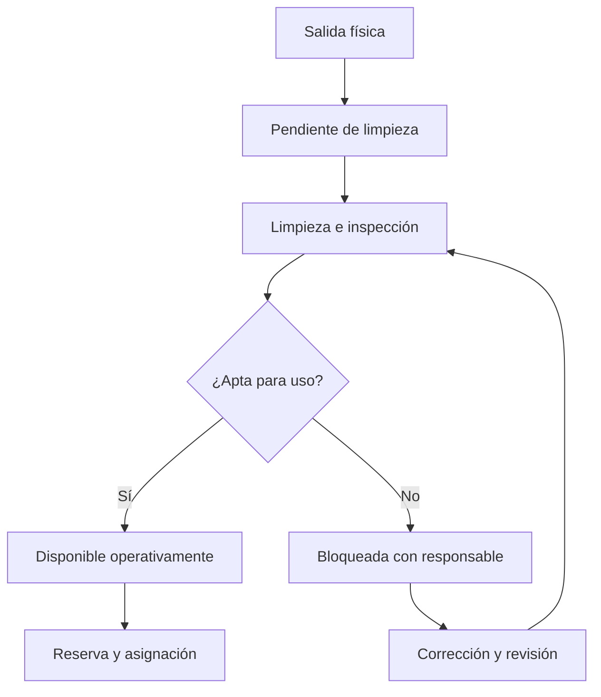

# Hospitalización, capacidad y ubicaciones
Fuentes H701/H703/H715/H722 como referencias con límites de lectura en 08. Estados/invariantes siguientes son propuestas propias para validación, no estados institucionales confirmados.

## HOS01 — Solicitud, aceptación e ingreso
Orden/indicación de ingreso vincula origen, episodio, profesional, prioridad, necesidades de aislamiento, movilidad y soporte. Servicio receptor acepta según capacidad clínica/operativa; coordinación de camas propone ubicación. Confirmar identidad/pulsera y evaluación inicial con responsable. Una reserva no inicia estancia física; registrar llegada al servicio y entrega aceptada.
No duplicar paciente al pasar de emergencia/quirófano a sala. Mantener relación de episodios y fuentes según v3/v6. Capacidad y autorización de servicio prevalecen sobre habitación físicamente vacía; no asignar UCI si carece de equipo/personas necesarios.

## HOS02 — Estados y disponibilidad
Separar cama física, plaza habilitada, ocupación, reserva, limpieza y bloqueo técnico/sanitario. Cama vacía puede seguir no asignable. Registrar bloqueo, motivo, autoridad, alcance y revisión; levantamiento requiere responsable. Aislamiento afecta compatibilidad de habitación compartida, sin divulgar diagnóstico al tablero público.

El gráfico solo describe liberación sanitaria/operativa. Reserva puede coexistir como solicitud futura sin declarar aptitud actual. Definir cuándo y quién verifica según SOP local; no exigir un análisis microbiológico universal para toda liberación.

## HOS03 — Traslado interno y temporal
Solicitud identifica origen/destino, motivo, necesidad de acompañamiento/soporte, documentación e intervenciones pendientes. Receptor acepta; confirmar salida/llegada y relevo. Traslado cancelado libera reserva destino sin alterar ocupación real origen.
Paciente que sale a imagen o procedimiento no se considera automáticamente dado de alta: distinguir ausencia temporal, cama retenida y traslado definitivo. Historial conserva intervalo y unidad; corrección no reescribe estancias anteriores. Dos confirmaciones concurrentes no dejan al paciente en dos ubicaciones activas incompatibles ni dos pacientes en plaza exclusiva.

## HOS04 — Ronda y continuidad diaria
Lista de problemas activos, órdenes, resultados, interconsultas y plan del día con dueños. Orden modificada propaga versión a ejecutores y confirma tareas afectadas; no copiar nota de ayer como evaluación de hoy. Diagnóstico probable/confirmado/resuelto se distingue. Interconsulta recibida no significa recomendación ejecutada.
Rehabilitación, apoyo psicológico/social y terapia respiratoria se integran según necesidad y oferta real; tarea guarda aceptación, evaluación y seguimiento. Restricciones/consentimiento se definen clínico/legalmente, sin inventar procedimientos institucionales.

## HOS05 — Censo y métricas
Censo por hora incluye ocupado, reservado, bloqueado, pendiente de limpieza, habilitado y operativo. Ocupación requiere denominador explícito (plazas operativas o habilitadas), no comparar tasas con bases distintas. Estancia usa intervalos/fuentes y reglas para ausencias; mortalidad/readmisión requieren definición clínica/población, sin inferir prevención de un cambio de pantalla.
Coste de estancia y tarifa pueden usar cortes distintos: política contable/contrato se documenta, no redondeo supuesto de 24 horas. Traslado conserva unidad de coste y evita doble día cobrado por la misma regla contractual.
